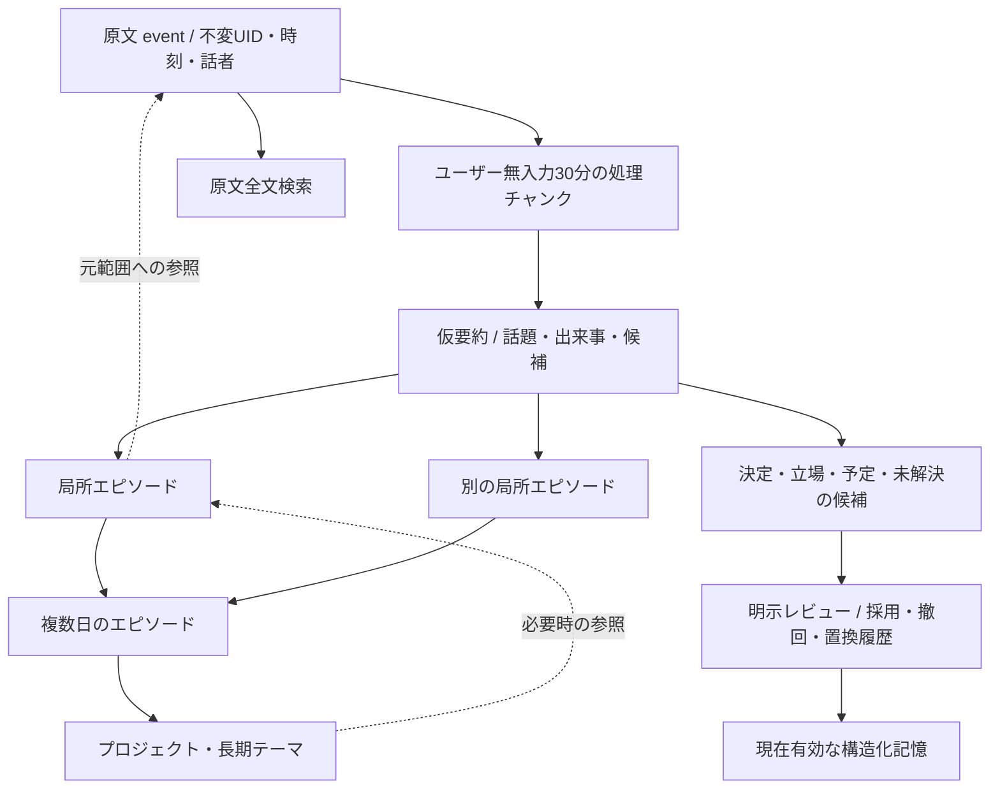

# エピソード記憶・多段階要約

2026-09-23。契約 `episode.multiresolution.v1`、正規DB schema 5。

## 目的と境界

原文を一次情報として永続保持し、仮要約・意味エピソード・構造化候補を追記する。日付・無入力・処理容量による区切りは処理境界であり、意味境界ではない。要約の誤りを修正するときも、原文と過去の派生記憶を上書きしない。

初期の権限・統合範囲は同一principal、conversation、context、sandbox。日をまたいだ統合・continuation/reconnectはこの範囲内で行う。別会話の原文を自動で集約しない。複数会話を統合する場合は、明示的なcollectionと認可の契約を別途設ける。

## 原文と処理チャンク

原文は既存の不変`event`を再利用する。`id`がsource UID、`content`がraw text、`role`が話者、`event_time`が時刻、recordの`conversation_id`が会話識別子となる。`context_key`、任意の`room_id/session_id`、既存のactor/model/source-message情報とprovenanceを保持する。過去の原文に新フィールドを自動追加しない。旧原文のcontext未指定は`conversation`として読解する。

チャンク確定の初期方針は次のとおり。

- 最後のユーザー入力から30分以上無入力なら、その時点までの最終発話を終点として確定する。助手・toolの応答で30分のタイマーをリセットしない。
- 生成中の応答がある場合は待つ。呼出し側が`response_in_progress=false`を指定しても、本体が未完了attemptを検出した場合は確定しない。
- 応答終了が不明な場合、時間だけを根拠に完了・失敗を推測しない。hostが正規の応答完了または失敗を記録するまで、該当チャンクを保留する。
- 次のチャンクは確定済みの連続した原文範囲の次から開始する。日付・30分ごとの固定枠では分割しない。
- `max_events/max_characters`を明示した場合は、ユーザーの次の発話前で補助分割する。一つのユーザー発話とその応答群を途中で切らず、単一ターンが上限を超えた場合は警告を返して原文を保持する。
- APIのclockは本体が決める。任意の未来時刻を要求本文へ指定して確定を早めることはできない。

各チャンクは対象event UID、開始・終端・無入力成立時刻、確定理由、処理policy、scope、path、provenanceを保存する。無作業pollでは新たなreceiptや空チャンクを増やさない。

## 仮要約・日次整理・階層

仮要約にはsummary、topics、events、decision/stance/intent/unresolved候補、related_entities、原文spanを保持する。対象チャンクの全eventへ辿れることを確認し、一部原文だけを黙って対象外にしない。要約文の意味的正確性は構造検証とは別の評価対象である。

日次整理は**日本時間03:00**に前日までの未処理の仮要約を対象にする。03:00より前の通常pollは前々日までを対象とする。未確定チャンクは待ち、遅れて確定・要約された過去分も次回以降に回収する。停止期間の取りこぼしを防ぐため、日付だけを「完了済み」とするローカル印は使わない。

日次モデルは、分離・統合、新しい局所エピソード、複数日・themeの上位ノード、過去エピソードへのcontinuation/reconnectを提案する。`child_refs`と同一提案内の`child_local_ids`で複数親のDAGを作る。同じ原文spanを複数ノードで使ってよい。階層の循環、存在しない参照、親より高い粒度の子は拒否する。日次入力の原文provenanceが出力のどこにも残らない提案は全体を拒否する。

モデル呼出しはworkerで実行し、DB transactionを保持したまま待たない。APIは準備時のinput manifest、入力版、host、scope/path、原文digestと引用範囲をcommit時に再検証する。複数workerが同じ仮要約入力を処理しても、一方がcommitした後にもう一方が二重登録することを拒否する。

## 保存する記録

| kind | 役割 | 更新 |
|---|---|---|
| `event` | 一次情報。再要約の唯一の原文根拠 | 不変 |
| `episode_chunk` | 無入力等による処理範囲 | 不変 |
| `episode_summary` | 仮要約、話題、候補、対象原文 | 不変。再生成は新UID |
| `episode` | local / multi_day / theme、子参照、関連、原文由来 | 不変。再生成は新UID |
| `structured_candidate` | user_decision / user_stance / user_intent / unresolved | 不変 |
| `structured_review` | 確認・撤回・置換、対象版、前レビュー参照 | 追記のみ |
| `artifact_reference` | 現在値を持つ外部正本の場所と根拠 | 不変。変更は後継参照 |
| `episode_job` | 再現可能な入力manifest、host、policy、処理対象 | 不変 |
| `episode_job_state` | commit状態、出力参照、提案digest | 正規transactionと期待版で管理 |

原文spanはevent UIDと版、未正規化UTF-8テキストのSHA256、Unicode codepointの半開区間`[start,end)`、一致するquoteを持つ。UTF-16単位やJSON文字列のhashと混同しない。全派生記録はsource/reason/confidence/created_at/decay・expiryを含む既存provenance契約を援用する。生成結果のconfidenceは未評価、一般化重みは0とし、要約回数・感情・同じ原文の重複所属で強化しない。

## 構造化候補と現在状態

仮要約内の四分類は専用`structured_candidate`にも保存する。ユーザーの決定・立場・予定には原ユーザー発言のspanを要求し、助手の要約をユーザー発言へ変換しない。候補は日次処理からも追加できる。

候補の登録だけでは通常の構造化想起へ採用しない。`review`権限の明示操作で、原発言に対する忠実性を確認して現在状態へ採用する。これは世界についての真実性の判定ではなく、辞書的知識への自動昇格でもない。

`confirm/withdraw/supersede`は追記レビューとして保存し、直前レビューの参照を期待値として検査する。同一時刻に複数レビューがあっても、正規監査のcommit順で最新を決める。置換先は自動採用しない。先行する現在状態を明示的に置換した後、新しい候補を確認する。

unresolvedは確認時に`active/blocked/deferred/resolved/abandoned`を指定できる。未解決を負の報酬に変えず、既存controllerの自動駆動や恒久重み更新にも直結させない。

## 想起と外部正本

`POST /episodes/query`は次のmodeを提供する。

| mode | 戻す内容 |
|---|---|
| `auto` | 外部正本参照、確認済み構造化記憶、上位エピソード。利用優先順位を明示 |
| `episodic` | theme → multi_day → local → 仮要約の順で入口を選ぶ。親の下位は重複展開しない |
| `structured` | 現在確認済みのユーザー発言・未解決状態。履歴指定時は未採用・撤回・置換を区別 |
| `raw` | 原文全文への直接検索。scope/path内に限定し、要約を経由しなくてよい |
| `artifact` | 外部の現在状態の正本を指す参照 |

`target_ref`を指定したepisodic検索は子階層を、raw検索はその派生記憶の原文範囲を取得する。通常想起では原文spanのUID・版・digest・offsetを保ちつつ、すべてのquoteを要約へ再添付しない。原文が必要になった時に明示的に解決する。結果数制限と未返却の有無を明示し、LLMのcontextに独自固定上限を設けない。

外部成果物のURIは登録時に開かない。任意ファイルの探索やURL取得はしない。結果には`current_state_authority=external`、`requires_authorized_refresh=true`、`current_state_verified=false`を返す。実際の再取得は、その成果物へアクセスする権限を持つhost/toolの責務とする。現在値を確認できない場合は、過去の記憶を現在の実装状況と断定しない。

通常の`/context/runs`へは`episode_recall`と`episode_target`を接続する。

- `HIPPOCAMPUS_V02_EPISODE_MODE=disabled`（既定）: 通常注入は従来どおり。要約APIや明示workerの処理可否とは別。
- `shadow`: 新しい想起結果をrunへ記録し、通常packetには入れない。
- `enabled`: `hippocampus.packet.v0.4`の`episodic_recall`へ注入する。辞書的記憶のmodeは独立。

選択、編成、最終保持を区別し、保持観測にepisode/structuredの版参照を記録する。採用状態・階層・modeが変わった後の古いrunは、新attempt/dispatch前に拒否する。モデル内部で使われたかは未観測のまま。

## 再生成

再生成には明示的な対象参照と新しい操作IDを使う。アルゴリズム・prompt・modelの版を保存する。原文、旧要約、旧エピソード、過去のreviewを削除しない。

仮要約の再生成は現在の要約を`supersedes_ref`で指定する。エピソード・外部正本参照も同様に後継を指定し、同じ先行ノードを複数の後継が競合して置換することを拒否する。古い子に依存する上位要約は、通常想起から外して再整理の対象とする。過去表示ではそのまま保存し、新しい子を古い文章へ差し替えない。

生成器はJSON/schema/原文照合に失敗した出力、拒否、不完全終了、tool呼出しを成功扱いしない。失敗出力を勝手に補修してcommitしない。再実行で入力pathが変われば新しいmanifestを準備する。

## APIと権限

すべて既存のBearer認証とprincipalを利用する。ブラウザーやモデル出力にprincipal/hostを任意選択させない。

| API（`/api/v0.2`以下） | 権限 | 副作用 |
|---|---|---|
| `POST /episodes/chunks/seal` | write | 条件を満たしたチャンクだけ追記 |
| `POST /episodes/jobs/prepare` | write | 仕事がある場合だけmanifest保存 |
| `POST /episodes/jobs/{job_id}/commit` | write | 検証成功時に派生記憶をまとめて保存 |
| `POST /episodes/query` | read | なし |
| `POST /episodes/structured/reviews` | review | 採用履歴を追記 |
| `POST /episodes/artifacts` | review | 外部正本ポインタを登録 |

要約workerの通常処理はread/writeだけで行える。review/control/learn/adminは要約のために追加しない。APIからmodelを呼ばず、workerをimport・本体起動によって自動開始しない。

## 起動・移行・検証

新DBはschema 5。既存DBは明示的な停止中upgradeが必要で、自動upgradeはしない。schema 4へ新コードを通常起動すると拒否する。移行では原文全文検索用`raw_event_fts`を構築し、派生kindの不変制約を追加する。原文record・既存監査prefixを維持し、再開可能な一方向migrationとして扱う。

`scripts/upgrade_v02_schema.py`は`--target-schema 5`に対応する。旧schema2/3/4の操作を再確認する場合は、その当時のtargetを明示する。旧backupへの自動巻戻し、旧APIの復活は行わない。

明示workerは`scripts/run_episode_maintenance.py`。接続設定、conversation、context、モデル接続先・model名、`--once`または`--loop`を指定する。通常loopは60秒ごとに無入力確定とバックログを確認する。実行結果やエラーへ本文・credential・provider応答を出力しない。従来の`/nightly/run`は決定的な再確認であり、この生成型要約workerを起動したことにはならない。

単体・統合試験は`test_episode*.py`にある。架空のローカルprovider、API、workerを通す一貫試験を含む。実モデル評価器`scripts/evaluate_episodes.py`は新規架空会話だけを使い、既存DB・credential・実会話APIを引数として受け取らない。実対話本文を開発・検収のために読み出さない。

未評価の点は、生成モデルの要約忠実性・意味境界・決定/予定の分類精度、長期の巨大DAGと多量バックログの性能、複数会話collection、外部正本を再取得するhost連携。語句照合とschema検証の成功を、これらの意味的品質の保証へ読み替えない。
