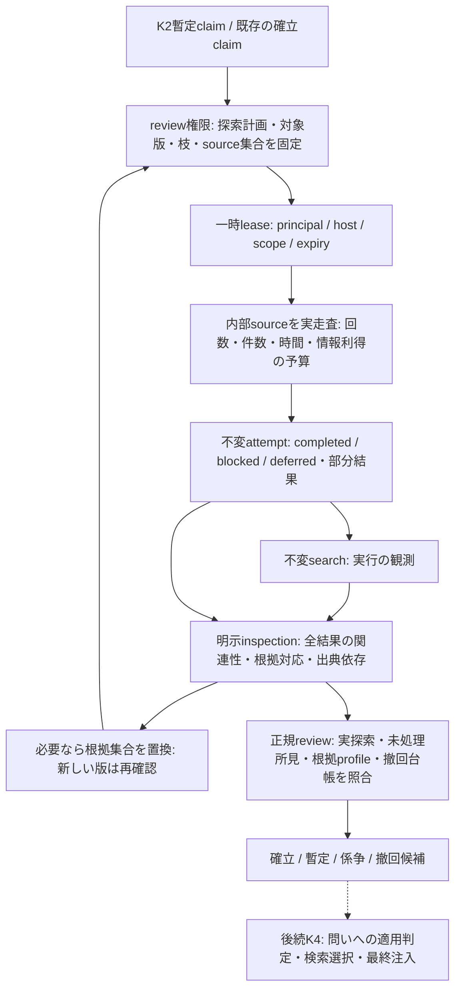

# 辞書的記憶 K3: 反証探索と明示審査

2026-09-21。K2の暫定候補から、反証探索の実行、検索結果の内容照合、出典依存の調査所見、K1の採用・保留・係争・撤回へ接続した。初期実装は**保存済みの正規sourceに対する実検索と、認可された明示審査**である。外部検索connector、モデルによる自動意味評価、自動review、通常回答への辞書的記憶注入は含まない。

コードはschema **4**を要求する。schema 1/2/3からの起動時変換はしない。以下は機能仕様であり、稼働環境へ配備した記録ではない。

## 1. 処理と責務



探索器はsource UIDを返す。検索一致は支持・反証・独立性の判定ではない。検索完了は反証不発見という意味でもない。検索・inspectionの成功によってclaimの状態、world-claim confidence、記憶の三重み、感情、一般化強度を変更しない。知識状態を更新する経路は既存の認可review commandである。

K0の副作用のない`review_decision`は基礎契約を検査する。K3ではこれに加えて、サービスが実行来歴と全履歴の未処理所見を解決する。K0単独の判定をK3採用証明として使わない。保存したreviewも、現在の問いへの適用・注入を許可する証明ではない。

## 2. 探索計画と停止条件

計画はclaimのrecord/claim/evidence-set版、scope、path_revisionと、その時点で選択枝上にある同scopeのcanonical source参照・digestを固定する。後から登録されたsourceは含まれない。再確認には新しい計画を作る。

次の各目的にquery、または該当しない明示理由が必要である。

| purpose | 確認すること |
|---|---|
| falsification | 主張が誤りである場合に観測される条件 |
| alternative_explanation | 同じ観測に対する別の説明 |
| boundary_case | 成立条件の外や一般化できない場合 |
| source_correction | 原出典の訂正、撤回、帰属の誤り |

`internal_corpus.lexical.v1`はcasefold後の部分一致を行う。termsがあればOR、なければquery text全体を使う。意味検索ではなく、同義語・日本語の表記揺れ・含意を自動解決しない。否定語の追加だけで反証探索が十分になったとは主張しない。

| 予算 | 既定値 | 設定範囲 |
|---|---:|---:|
| query_limit | 16 | 1〜16 |
| source_limit | 128 | 1〜2000 |
| result_limit | 32 | 1〜256 |
| time_ms | 1000 | 1〜30000 |
| min_expected_information_gain | 0.05 | 0〜1 |
| lease_seconds | 60 | 1〜300 |

これらは探索実行の予算であり、Hippocampusの注入コンテキスト上限ではない。情報利得は計画作成者の見積りであり、校正済みの自動推定ではない。予算不足や低い情報利得は`deferred`、実行不能・期限切れ・対象変更は`blocked`となる。途中の結果と停止理由を残す。未実施・打切り・実行失敗を`none_found_in_scope`へ変換しない。

計画・試行・結果は永続履歴であり、実行権のleaseだけがscopeとexpiryを持つ。期限切れは履歴削除を意味しない。同期実行APIであり、常駐worker・自動再試行・期日schedulerはまだない。再試行は新しいidempotency keyを持つ明示executeで行う。同じkeyの再送は元の結果を返し、入力の変更は拒否する。

## 3. 内容照合と隠れた出典依存

`knowledge_search_observation`は手動inspectionを不変保存する。search_refまたはattempt_refを指定する場合は、取得結果全件を次のいずれかに分類する。旧版の検索や中断試行も、現在のclaimに対する再確認対象にできる。

| disposition | 条件・意味 |
|---|---|
| irrelevant | この命題へ適用しない明示理由。現根拠集合に同sourceの未解決反証があれば採用を許可しない |
| evidence_linked | 同source・現在のtargetの正規evidence参照へ接続。採用には内容照合がmatchedであることが必要 |
| unresolved | 関連性や内容を未解決として保持。採用を保留する |

source reliabilityは`source_reliability`専用Assessmentとして保持する。world-claim confidenceを代入できず、検索結果の関連性や独立性にも自動変換しない。支持と反証は同じ原文照合・scope・版検証を受ける。

独立性所見には対象evidence pair、判定、理由、調査方法、参照sourceを持たせる。independentの申告にはoriginal_provenance_inspectionと確認資料が必要で、既知の共通起源、未解決起源、同一sourceは拒否する。モデル出力やsystem指示だけで原起源の独立性を証明できない。何を確認して共通起源の可能性を排除したかは、認可reviewerが理由に記す。参照が存在すること自体は意味的な証明ではない。

隠れた依存はsource UID/版へ正規化し、依存の連鎖を調べる。A→B→Cが記録されていれば、根拠集合からBを外してもAとCを独立にしない。根拠IDの再発行でも依存は消えない。unknownへの変更だけで既知の依存を消さず、反対の判定には新たな原起源調査を必要とする。

## 4. 採用と再評価の条件

K3で新たにadoptする場合、少なくとも一件の**正規実行器によるcompleted search**を指定する。manual attestationは補足履歴として残せるが、それだけで採用できない。現在のclaim record版・pathに対する計画は、正規leaseに結び付く最新試行がすべて完了している必要がある。未実行・実行中・失敗・打切りの計画を、別の成功した検索だけで隠さない。

さらに、サーバーが同claimの全検索・試行の結果と過去の反証evidenceを解決する。呼出側のsearch_refsだけを調べるわけではない。古い結果の未解決事項は、evidence-set版や命題版を更新しても自動消滅しない。現在の版・pathで「適用外」または「現在の根拠へ接続済み」と明示的に確認する。検索を経由せずに保存された古い反証evidenceは、search_ref/attempt_refなしのinspectionで再確認できる。

inspectionの新旧は壁時計やUID順ではなく監査sequenceで決める。使用した所見参照、確認義務、未解決理由をreviewへ保存する。採用以外の保留・係争・撤回は未解決を残して実行できる。新しい反証候補を得ただけで、確立claimを自動的に偽へ変更しない。

推奨操作順は次の通り。

1. 主張を暫定保存し、現在の根拠を明示評価する。
2. 四目的を持つ計画を作り、実行する。
3. 全結果を確認する。必要な根拠を追加・差替えすると新しいevidence-set版になる。
4. 新版で探索・所見を再確認する。旧結果や外した反証の確認義務も明示解消する。
5. 現在の対象へreviewを行う。profile、反証、独立性、最新撤回参照、再確認期日を検査する。

保留などでclaim record版が変わった場合も、次のadoptには新しいrecord版の計画が必要となる。これは初期の保守的な方針で、再確認量が増える。将来の最適化でも、旧所見・依存・撤回を暗黙に引き継いで採用証明へ変換しない。

## 5. APIと保存

すべて`/api/v0.2/knowledge`以下。認証されたprincipal/hostを使用し、クライアントが対象principal・実行器・lease token・実行結果を注入する欄はない。

| API | 権限 | 用途 |
|---|---|---|
| POST /claims/{id}/search-plans | review | 計画・対象・corpusを固定 |
| POST /search-plans/{id}/execute | review | 実探索と試行・結果の保存 |
| GET /search-plans/{id} | read | 計画履歴 |
| GET /search-attempts/{id} | read | 部分結果を含む試行履歴 |
| POST /claims/{id}/search-observations | review | 全結果または出典依存の明示inspection |
| GET /search-observations/{id} | read | 所見履歴 |
| POST /claims/{id}/reviews | review | K3条件を加えた既存の正規更新 |

書込応答は保存したID・版のack、読取はhistorical_snapshotで、現在の適用判断を兼ねない。通常の候補記録用write credentialへreviewを自動付与しない。

schema 4は`knowledge_search_plan / knowledge_search_attempt / knowledge_search_observation`を不変kindへ追加する。`knowledge_search_lease`は一時状態として版競合を検証して更新する。署名監査、checkpoint、backup/restore、principalの明示削除は既存基盤を再利用する。

```text
python scripts/upgrade_v02_schema.py --db demo.db --operation-id demo-k3 --target-schema 4
python scripts/upgrade_v02_schema.py --db demo.db --operation-id demo-k3 --target-schema 4 --apply --service-stopped
```

署名backupとwrite元の停止が先行条件である。移行先の異なるoperation IDを使い回さない。旧K1/K2のreceipt再開は当時のtarget 2/3を明示する。schema upgradeと旧semantic memoryの候補化migrationは別操作のままとする。

## 6. 限界と次工程

内部corpusの語句検索なので、外部世界の反証網羅性は保証しない。計画固定後の新資料は新たな探索を要する。時間制限は処理単位間の検査であり、単一の大きな文字列処理を強制中断するものではない。所見は人または認可ホストの明示申告であり、引用の意味や独立性を自動的に実証してはいない。

K4では、エピソードと辞書的記憶の候補取得、問いの条件・時点・scopeを満たす採用view、packetの区画化、selectedとhost_finalizedの版別観測を接続する。古いK1レビューをK3済みとみなさず、現行policyの再評価を要求する。外部connector・抽出/評価モデルは同じ正規契約を満たす実装を追加し、実資料の品質・速度・費用を別に測定する。
