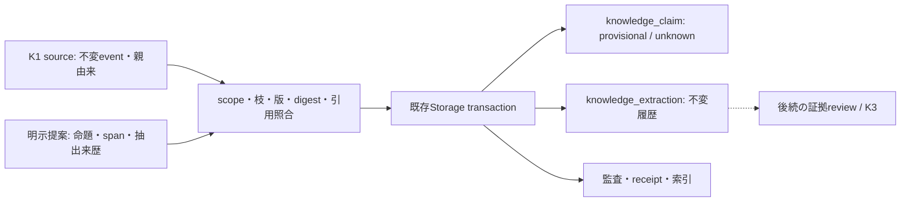

# 辞書的記憶 K2: 原文に結び付いた暫定候補

K3追記: 現行コードは[内部反証探索と明示inspection](knowledge-countersearch-k3.ja.md)を追加し、schema **4**を要求する。以下のschema 3とstage K2の記述はK2時点の仕様である。現在の配備にはtarget 4への明示upgradeを使用する。抽出器の契約は変えていない。

2026-09-21。K1の保存・認可を使い、明示的な構造化提案から候補と抽出来歴を保存する。最初の抽出器は`explicit_proposal.v1`であり、自然文から主張を自動推論するモデルではない。会話同期・nightlyへの自動接続、外部検索、知識採用、通常回答への注入は有効化しない。

## 1. 入力と正規保存

[extraction_contracts.py](../v02/extraction_contracts.py)に入力、保存snapshot、副作用のない抽出器interfaceを定義し、[extraction_service.py](../v02/extraction_service.py)で正規commandへ接続する。



`POST /api/v0.2/knowledge/extractions`にはwrite権限が必要で、review権限は要求しない。`GET /api/v0.2/knowledge/extractions/{id}`はread権限による履歴読取である。汎用records読取にも新kindを追加する。

requestは`idempotency_key / reason / path_revision / scope / extractor_version / proposals`を持つ。scopeのprincipalとhostは認証から解決する。extractor_versionは現在の実行器と一致する固定値だけを受け付け、モデルが実行されたという任意の識別子を受け入れない。

| 提案項目 | 契約 |
|---|---|
| proposition | K0のProposition。原文引用と命題を分け、主体・帰属・否定・量化・条件・時点を保持。不明項目は不明のまま |
| spans | source UID/版、start、end、quote、unit。一件以上。同じspanの重複と同じsourceの異版混在は拒否 |
| 原文位置 | Unicodeコードポイントの半開区間`[start, end)`。サーバー上の不変原文とquoteの完全一致を検査。空範囲、範囲外、UTF-16等の別unitを拒否 |
| confidence | targetはclaim_extraction、scoreはnullまたは0〜1、calibratedはfalse。命題が現実に正しい確信度ではない |
| reason / limitations | 抽出理由と限界。来歴として保存し、証拠評価の代わりにはしない |

例えば、架空のsource本文が`🙂青い灯台`なら、`start=1 / end=5 / quote="青い灯台" / unit="unicode_codepoint"`となる。JavaScriptのUTF-16位置をそのまま送ると一致しない場合がある。API利用側で合意した単位へ変換する。

`assessment / knowledge_state / source_independence / counterevidence_status / retrieval_weight / generalization_weight / salience / content_check / relation`を提案へ混入すると拒否する。span一致は内容が命題を支持する証明ではなく、原文中の命令を実行する入口でもない。

## 2. 抽出来歴と非結合

`knowledge_extraction`は、生成したclaimの初期版、提案、検証したspan、scope、path_revision、抽出器・policy版、同一性のfingerprint、関連claimの版付き参照、provenanceを保存する。不変記録であり、quoteやconfidenceを後から上書きしない。

各spanにはsource digest、role、actor、モデル来歴、親source、event参照集合、origin IDsをサーバー側から付ける。提案者が本文や来歴を置き換える入力欄はない。親のあるsourceはその親由来を保持し、assistant由来の資料を一次観測に変更しない。originの独立性は未評価である。異なるIDや多数の反復から独立性を認定しない。

新claimは必ずprovisional、world_claim assessment unknown/null、counterevidence unassessed、source independence unknownで作る。抽出confidenceは抽出来歴の`claim_extraction`にのみ保存し、claimのconfidence・記録忠実度・情報源信頼性・三重みへ転送しない。通常のmemory、確立claim、withdraw台帳を変更しない。

provenanceは認可host、reason、confidenceと対象、created_at、非減衰理由、policy版、cause_refsを持つ。履歴にはexpiryを付けず、永久保存の記録と一時的な実行状態を混同しない。

## 3. 再送・照合・原子性

同じidempotency keyと同じcommandは、既存のreceiptを返す。同じkeyで異なるpayloadを送ると拒否する。返答はK1と同じ`recorded_revisions_only / not_evaluated`で、保存ID・版・kindのみである。

別keyでもscope、source版・span、命題、抽出器・policy、confidence・reason・limitationsを含む提案全体が同一なら、既存extractionと最初に作成したclaimの版を参照する。claimが後で編集・撤回されても、元の状態を再作成しない。新keyの場合は現在の枝・sourceを再検査する。旧receiptの再送は当時の保存事実であり、現在の利用許可にはならない。

注釈を変えた提案は別の抽出履歴・暫定候補として保持する。別sourceから同文を得た場合も自動mergeしない。同一scope・命題の完全一致で既存claimへの関連参照を残すが、支持・独立裏付け・採用可否を表すedgeではない。既存claimの根拠集合やassessmentを書き換えない。

候補、抽出来歴、索引、監査、receiptは同じtransactionで確定する。複数提案のうち一件でも検査や保存に失敗すれば全体をrollbackする。先に実行した抽出の結果を受け入れる場合も、保存時にpathと参照版を検査する。

## 4. schema 3と明示管理操作

新規DBはschema 3で作成し、`knowledge_extraction / knowledge_migration`をアプリケーションとSQL triggerの両方で不変にする。新コードは既存schema 1/2の通常起動を拒否する。実環境で新コードへ切り替える前に、署名backup、write元の停止、[明示upgrade](../scripts/upgrade_v02_schema.py)を行う。

```text
python scripts/upgrade_v02_schema.py --db demo.db --operation-id demo-k2 --target-schema 3
python scripts/upgrade_v02_schema.py --db demo.db --operation-id demo-k2 --target-schema 3 --apply --service-stopped
```

同じoperation IDは同じ移行先にだけ使う。schema 1→3は1→2→3の構造変更を一つのtransactionで確定する。過去のK1移行receiptを照会・再開する場合だけ、当時のoperation IDと`--target-schema 2`を明示する。schemaを下げたり、旧通常APIへ戻したりする指定ではない。

backup/restoreは追加記録を含む。異なるschemaのbackupを稼働DBへ直接上書きしない。明示principal削除は追加記録も対象とし、他principalを保持する。未完了schema upgradeや候補化migrationのmarkerがあれば通常操作を拒否し、同じ管理操作として再開する。

## 5. 候補化migration

schema更新と、既存semantic等から候補を作るデータmigrationは別の明示操作である。[migration実装](../v02/knowledge_migration.py)と[CLI](../scripts/migrate_knowledge.py)で、原memory・event・sourceの版とdigest、選択path、原文span、構造化提案、隔離理由をmanifestへ固定する。通常起動、会話同期、nightlyからは呼ばない。

原eventへ辿れないmemory、scopeが不明なもの、枝外の資料を黙って候補へ変換しない。旧要約を新しいuser発話に合成せず、旧confirmedや旧confidenceを引き継がない。停止中の適用でも、K1 source登録とK2候補保存の共通transaction関数を使う。元のrecord・三重み・assessmentはそのまま保持する。

入力JSONの`items`には、memory_ref、memory_digest（正規memory data全体のdigest）、scope、path_revision、proposition、event_ref/event_digest（event本文のdigest）/start/end/quoteを持つspans、reason、任意のconfidence・limitationsを指定する。対象memoryはsemanticに限定し、原eventへの親memory参照も辿る。digestは既存`contracts.digest`の正規JSON方式であり、裸の文字列を直接SHA-256にかけた値ではない。

```text
python scripts/migrate_knowledge.py --db demo.db --operation-id demo-candidates --principal demo-owner --input demo-proposals.json --manifest demo-plan.json
python scripts/migrate_knowledge.py --db demo.db --operation-id demo-candidates --manifest demo-plan.json --apply --service-stopped
```

最初の呼出しはDBを読取のみで検査し、新しいmanifestファイルへ計画を保存する。既存manifestを上書きしない。適用は保存したmanifestだけを使い、別の入力・principalへの差替えを受け付けない。DBが計画時から変われば、同じ内容だと仮定せず再計画を要求する。

候補・出典・不変migration receipt・署名checkpointを一括確定する。commit前の失敗はrollbackし、commit後の外部anchor反映失敗は同じmanifestとoperation IDで再開する。markerを手で消さず、履歴を再importしない。完了済み操作の再送は当時の結果であり、その後の変更を巻き戻さない。全principalの保持検証に必要な個別baselineはローカル管理manifestにだけ残し、特定principalが読むreceiptから別principalの記録識別情報を返さない。

## 6. 検証と次の接続

架空資料によるAPI試験で、引用・版・枝・principal・sandbox、同一処理の再送、異なる由来、既存確立/撤回の保持、途中失敗のrollback、confidenceの非結合、通常packetへの非注入を検証する。保存管理試験では新kindの不変性、schema更新、中断再開、署名backup/restore、明示削除を検証する。

現在のstatusはstage K2、explicit_proposal_acceptance=trueを返す一方、automatic_extraction、countersearch_execution、context_injectionはfalseのままである。自然文からの抽出品質は、span一致、帰属・否定・量化・条件の保持、追加命題、見逃し、遅延・費用を別途比較して評価する。K2の保存成功をK3の証拠評価やK4の利用成功とは扱わない。
