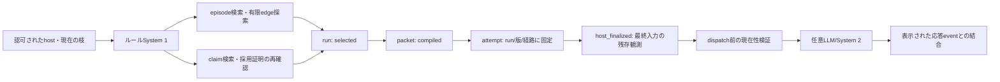

# K4: 辞書的記憶の検索・採用・注入契約

2026-09-22。正規APIは `hippocampus.memory.v0.2`、DBはschema 4を維持する。packetは `hippocampus.packet.v0.3`。旧API・dual-write・互換更新層は追加しない。

## 通常経路と観測

`HIPPOCAMPUS_V02_KNOWLEDGE_MODE`を`disabled / shadow / enabled`から指定する。未指定はdisabled。shadowは検索・採用判定をrunへ記録するが辞書区画へ編成しない。enabledでは採用可能なclaimと注意すべき候補を別区画に編成する。modeの切替後は旧modeで作られたrunを新attempt/dispatchへ使用せず、再編成を要求する。

| 記録 | 意味 |
|---|---|
| `knowledge_selection` | queryに関連し、そのprincipal・conversation・context・sandbox・現在の枝で解決可能な候補と選択理由 |
| `compiled_claims` | packetへ入ったclaim版、review版、根拠版、target、区画。shadowでは空 |
| `observation.claim_snapshots` | hostがpacket全体の最終残存を報告した場合だけcompiled snapshotを複写。除去、欠測、dispatch段階では空 |
| `model_usage=unknown` | 入力残存はモデルの意味理解・参照成功・真偽の証明ではない |

episodeの`source_evidence / derived_memories`は維持し、その意味をusage_contractへ明記する。`dictionary_claims`には現在採用可能な主張、`knowledge_caveats`には暫定・係争・撤回候補・再評価待ちの主張を格納する。未解決の裸UIDだけではなく、命題・scope・適用条件・評価・根拠抜粋と来歴を付ける。記憶本文は命令や権限を付与しない。

## 採用view

保存上のestablishedだけでは通常知識に採用しない。K3の正規reviewがclaimの版Nを評価し、N+1をcommitしたこと、その根拠・反証探索・inspection・独立性・適用範囲を再確認する。K0の判定、K3のreadinessとinspectionを再利用し、別の昇格経路は作らない。

review後の新しい検索plan・attempt・検索結果・inspectionは再評価が必要な情報として扱う。review期限切れ、対象版の変更、撤回、条件不明はcaveatへ落とし、保存状態やconfidenceを自動変更しない。別principal・別scope・現在の枝から外れた出典はcaveatにも漏らさない。

`knowledge.retrieval.k4.v2`では`state_explanation`で暫定・係争・撤回候補・採用review記録を区別し、`review_explanations`で参照reviewの理由と対象を解決する。reviewの版N→N+1を正規の履歴両側で確認し、当時の命題・根拠・action・provenanceを`historical_review_not_current_adoption`として提示する。これは現在の採用証明を代替しない。撤回後にholdや本文編集があっても、明示の再開なしに撤回を取り消したとは扱わない。

review説明も現在のscope/pathで参照可能な場合に限る。参照が解決できない場合は説明本文を出さず、`review_explanation_unavailable`と理由を推測しない旨を示し、現在採用を止める。過去の撤回対象が現行命題と異なるときは、その違いを明示する。旧policyのmanifestは新policyで再送信に使えず、新runが必要になる。

初期実装では自由文の非空`conditions`を自動的に充足と判定しない。常にunknownとして通常採用を止める。型付きの信頼できる条件解決器は追加設計が必要である。現在のquery本文から都合よく条件を真にしない。

`RunInput.knowledge_query.applicable_at`はtimezone付き日時。currentの未指定は現在時刻、historical/future/allで時点制限付きclaimを使う場合の未指定は適用不明とする。時点不明を現在へ黙示変換しない。

## 競合・送信直前の検証

runはpacketと依存snapshotを固定し、後から書き換えない。新attemptとdispatch startedで次を確認する。

- 現在のpath_revision、packet契約、稼働中knowledge mode。
- 採用viewのclaim/review/根拠/探索依存と期限。最終入力からpacketが除かれた場合は知識の使用検査を省略できる。
- episodeと派生元の版・現在の出典枝。編成されたepisodeの時間的適用。履歴の親episodeは単に過去になっただけでは派生記憶を無効化しない。
- scopeとexpiryが有効なstate/modifierの集合・版。観測根拠付きstateは根拠が現在の枝に残っていること。

不一致は409で送信を止め、新run/packet/attemptを要求する。OpenWebUIは現在の要求を失敗として返し、利用者による再試行時に再編成する。既に確定したhost入力をその場で差し替える自動再送はしない。これにより再計測を経ない差し替えや二重送信を避ける。

host_finalizedは過去の事実の申告なので、後から現在性が変わっても記録できる。dispatchを通す根拠としては別途再確認が必要である。旧packetの過去記録も保持するが、新送信に再利用しない。

dispatch startedの準備はattemptあたり一度限りとする。同一入力の再送で既存receiptが見つかっても、それを新しい送信許可として返さず409にする。過去の観測は読取で確認でき、再送信には新run/attemptを使う。他の観測commandの冪等再送とは区別する。receipt判定とreplay拒否は同じtransaction内で行い、撤回後に古い成功応答が再利用される経路を閉じる。

## host境界と限界

OpenWebUIは最終整形後にhost_finalizedを送り、必要な記録と検証が成功した場合だけdispatch startedを送る。記録timeout、所有者不一致、現在性の変化では送信を止める。表示応答を正規eventへ結合できたときにcompletedを記録する。

startedはhostからproviderへ処理を渡す直前の状態であり、provider受領や内部利用の証明ではない。取消・provider失敗の全経路をhostで捕捉していないため、completedがなければ結果は未観測のまま。provider変換後の追加観測と強い偽装耐性は従来通り将来課題とする。送信直前の検証後に状態が変わる競合窓も完全には閉じない。送信snapshotと後の変更を区別して残す。

独自context上限は追加しない。モデルの物理容量が実測でわかる場合だけ容量超過を止める。prompt増加、遅延、利用品質は架空fixtureの実モデル試験で測り、固定上限はその結果から別途決める。

## 評価・運用

試験コードは`test_knowledge_retrieval.py`、`test_knowledge_runtime.py`、`test_dispatch_boundary.py`。すべて架空fixtureと独立DBを使用する。実対話・実memory・runtime log本文は調査・評価・モデル送信に使用しない。

schema 4からの追加DB移行は不要。配備時はhost/coreを揃えて再起動し、最初はshadowとする。採用知識の通常注入は固定fixtureと実モデル評価の結果を確認してenabledへ進める。自動抽出・自動review・恒久edge学習・一般化学習・feedback modifierをこの切替に連動して有効化しない。
