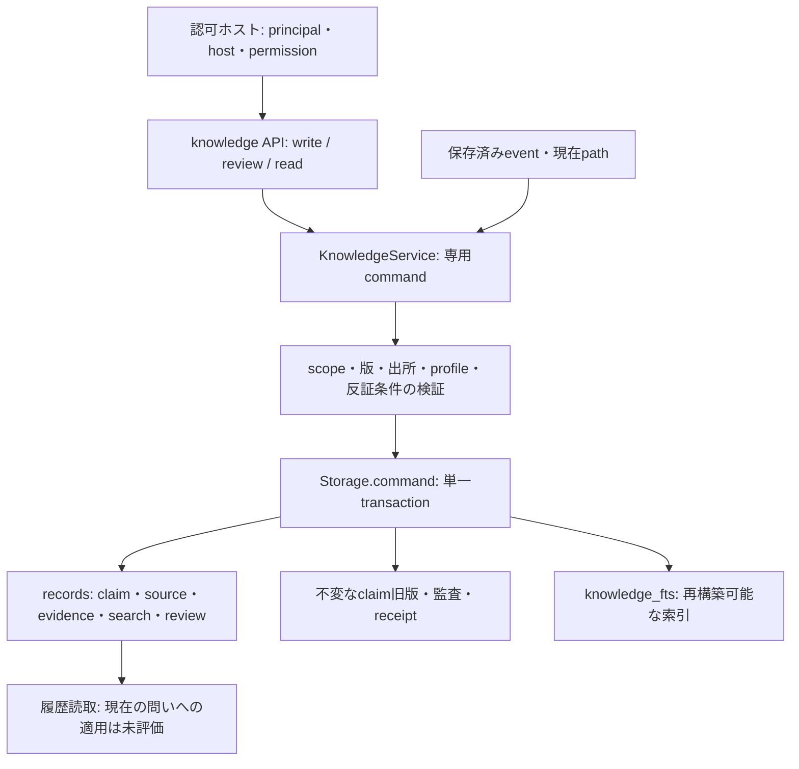

# 辞書的記憶 K1: 保存・更新・認可・監査

2026-09-21。K0の[知識契約](knowledge-contract-k0.ja.md)を正規保存とAPIへ接続した。現在の範囲は、保存済みeventからの出典登録、明示的な候補作成、認可された手動reviewの保存である。自動抽出、外部反証検索の実行、意味評価器、通常の記憶注入はまだ接続していない。

K2/K3追記: [原文span付きの提案受入](knowledge-extraction-k2.ja.md)、明示候補化migration、[反証探索と明示inspection](knowledge-countersearch-k3.ja.md)を追加した。現在のコードはschema 4を要求する。以下のschema 2はK1時点の説明であり、現在のupgrade既定targetは4である。過去のK1 operationを再開・照会する場合は`--target-schema 2`を明示する。K3ではmanual searchだけで新たにadoptできず、実探索と全結果の確認も必須となる。

## 1. 正規経路

実装入口は[knowledge_commands](../v02/knowledge_commands.py)、[knowledge_service](../v02/knowledge_service.py)、[knowledge_api](../v02/knowledge_api.py)。既存`Service`と認証基盤へ接続し、別のDB更新元や旧APIへの転送を設けていない。

## 2. APIと権限

基点は`/api/v0.2/knowledge`。すべて既存のBearer認証とprincipal/hostの対応を使用する。adminを暗黙にreviewへ読み替えず、指定のpermissionを要求する。

| 操作 | 方法とパス | permission | 主な入力 |
|---|---|---|---|
| 出典登録 | POST `/sources` | write | scope、現在path_revision、event_ref、任意のparent_source_refs、command情報 |
| 候補作成 | POST `/claims` | write | scope、現在path_revision、proposition、origin_refs、command情報 |
| 候補一覧 | GET `/claims?conversation_id=...` | read | 会話範囲 |
| 候補・履歴読取 | GET `/claims/{id}`、GET `/claims/{id}/history` | read | claim ID |
| 本文・条件変更 | PATCH `/claims/{id}` | write | 三種類の期待版、現在path_revision、新proposition |
| 審査対象の根拠集合を置換 | PUT `/claims/{id}/evidence` | review | 三種類の期待版、出典参照、原文span、関係・照合結果・理由 |
| 探索の実行報告を保存 | POST `/claims/{id}/searches` | review | 三種類の期待版、実行状態、scope、問い、結果参照、coverage・限界 |
| 採用・保留・係争・撤回review | POST `/claims/{id}/reviews` | review | 三種類の期待版、action、assessment、profile、検索参照、反証/独立性判断、再確認期日 |

command情報は`idempotency_key / reason / path_revision`。claimを更新・審査する操作には`expected_version / claim_revision / evidence_set_revision`を要求する。失効した版やpathは409、他principalの参照は404、権限不足は403、契約違反は422として拒否する。

principal、host、保存ID、保存時刻、provenanceの更新元、source本文・actor・digest、最新撤回はサーバーが決める。生の`KnowledgeReview`や`AdoptionContext`をAPI入力にしない。候補作成で状態やconfidenceを指定することもできない。

## 3. 出典と証拠の解決

K1の出典は**既存の不変event**から作る。会話、現在の選択枝、sandbox、参照版を検査し、本文・role・actor・event_timeをコピーしてdigestを計算する。由来不明の任意文書を原本として受け取る外部取込はK2以降で扱う。

別source IDで同じeventを登録してもorigin_idsは同じになる。親sourceを指定した派生資料は親の起源を引き継ぎ、自分の言換えeventを新しい独立観測として加えない。枝検証のため、親を含む全event参照を保存する。

根拠の抜粋は`span_start / span_end`で指定し、サーバーが原文から取り出す。空範囲・原文外を拒否し、原文spanとsnapshotを両方保存する。source_actor_id、source_digest、origin_idsは入力から受け取らない。

assistant eventを一次報告・直接観測・検証済み証明へ変更できない。system指示も独立した世界の観測としては扱わない。親sourceを持つ派生資料はsecondary/model_outputとして来歴を保持する。

内容照合、関係の分類、既知起源であること、独立性の判断はreview権限のある呼出者の**手動審査の記録**である。sourceのhiddenな共通起源をコードが自動発見したことや、資料の内容を自動検証したことを意味しない。

## 4. 永続オブジェクトと不変履歴

| kind | 保存形と更新契約 |
|---|---|
| `knowledge_claim` | 現在のClaimSnapshot。変更は専用commandだけ。proposition本文をknowledge_ftsへ反映 |
| `knowledge_claim_version` | 変更前のclaim_id、record version、snapshotを自動保存。上書き不可 |
| `knowledge_source` | eventの不変snapshot、親と起源、全event参照、scope、provenance。上書き不可 |
| `knowledge_evidence` | EvidenceSnapshotと原文span、manual_attestationの記録。上書き不可 |
| `knowledge_search` | CounterevidenceSearchとmanual_attestationの記録。上書き不可 |
| `knowledge_review` | KnowledgeReview、更新前後のrecord version、入力path_revision、手動reviewの記録。上書き不可 |

独立性の評価はknowledge_review内に保持し、別の通常更新元を増やさない。過去の根拠集合は古いevidence_set_revisionとして残す。主張ごとに、現在のclaim_revision/evidence_set_revisionへ結び付く全根拠をreviewへ組み込む。呼出者がreview時に不都合な一件だけを省く入力欄は設けない。集合そのものを置換する場合は別のreview権限commandと変更理由を必要とし、旧集合を削除しない。

本文・条件の変更はclaim_revisionとevidence_set_revisionを進める。根拠集合の置換はevidence_set_revisionを進める。どちらもprovisional、assessment unknown、反証unassessed、独立性unknownに戻し、現在reviewの採用効力を失わせる。元の状態と評価は旧版に保存される。三重みや旧記憶のconfidenceへは書き戻さない。

変更後snapshotのprovenanceには、本文変更、根拠集合置換、状態変更それぞれのreason、実行host、時刻、cause_refsを保存する。原候補のprovenanceは最初の版に残る。空の根拠集合への置換でも、除外理由を失わない。

## 5. reviewと問いへの適用を分ける

review commandは同じtransaction内で、認可されたprincipalのclaim、版、現在path、source・証拠・検索結果、最新撤回を解決する。adoptでは枝から外れた根拠を拒否する。hold・dispute・withdraw等は、参照の正当性と現在path_revisionを確認したうえで、枝から外れたclaimの採用を停止・保留できる。

採用にはK0のprofile・支持・反証・独立性・評価時刻の条件を要求する。review本文とclaimの値、履歴、FTS、監査、receiptは一括確定する。途中で検査や保存が失敗した場合、部分的な根拠やreviewを残さない。

K1で接続した`review_decision`は、**主張が宣言している条件の範囲内での審査**である。「この問いでその条件が成立している」とは主張しない。K0の`adoption_decision`は共通のreview検査に加え、別途解決したapplicable_atとconditions_satisfiedを要求する。K1では後者をtrueに固定して代用することも、クライアントのboolを受け取ることもしない。問いに対する適用と注入はK4の責務である。

最新のwithdrawの参照はedit・根拠置換・holdでも保持する。再採用にはそのwithdrawを`reopens_withdrawal_ref`で明示する必要がある。BEGIN IMMEDIATE内で最新のrecord versionを確認し、保存順序が一致することを保証する。同時刻の操作でも、時刻だけで先後を推定しない。

## 6. 再送と履歴読取

commandの返答は`records: [{id, version, kind}]`、`result_semantics=recorded_revisions_only`、`current_applicability=not_evaluated`に限定する。同一keyと同じ入力の再送は同じ保存事実を返し、本文・評価・weightを再更新しない。同じkeyで別payloadや別hostへ変更すると競合として拒否する。

再送時には過去の処理結果を返すが、**過去に採用されたことを現在の利用許可として返さない**。枝変更や撤回の後でも、receiptの意味は当時保存した版の識別にとどまる。

knowledge専用GETだけでなく、汎用`/records/{id}`と一覧でも`historical_snapshot / not_evaluated`を付ける。read権限は自分のprincipalの保存履歴を確認する権限として扱い、別枝や撤回後の原文を自動的に隠したり消したりしない。通常回答に使える知識一覧のAPIではない。

## 7. schema 2と管理処理

新規DBはschema 2を作成する。既存schema 1は通常起動時に読取で検出し、DDL適用前に拒否する。起動時migration、旧APIへのfallback、dual-writeは行わない。

[明示upgrade](../v02/schema_upgrade.py)と[CLI](../scripts/upgrade_v02_schema.py)はschema 1→2に限る。K1では既存semanticから候補を抽出しない。既存memory・event・監査prefixを維持し、知識用FTSと不変記録の制約、schema変更の履歴、署名checkpointを追加する。

実環境への適用は後続の切替作業として、次の順序で行う。

1. 対象DB・設定・監査anchorを確認し、現在のデータを含む署名付きbackupを既存の対応サービス／管理手順で作る。
2. write元を停止し、同じoperation IDでupgradeのdry-runを確認する。
3. 停止状態を明示してapplyする。通常APIはこの管理操作を提供しない。
4. 新schemaと署名・索引を確認し、対応コードでサービスを起動する。

CLIの既定はdry-runであり、適用には`--apply --service-stopped`が必要。upgrade自体は自動backupを作らない。DB transactionの確定後に外部anchorの反映が失敗した場合はmarkerを残して通常起動を止め、同じoperation IDで再開できる。markerを手作業で消して復旧したことにはしない。

backup/restoreは知識の旧版・根拠・review・FTSを含む。restore前にschema一致と索引を確認し、schema 1のbackupを稼働schema 2へ直接上書きしない。後続の書込を失う単純切戻しは避ける。署名・履歴の復元とschemaの前方更新を管理手順として検討する。

明示principal削除は全knowledge kind、旧版、receiptを対象にし、残す別principalの版・監査対象・FTSを維持する。backupや外部copyの残存報告は従来どおりであり、archiveや撤回を物理削除と表示しない。

## 8. 検証範囲と未実装

[保存層試験](../tests/test_knowledge_storage.py)と[API・domain command試験](../tests/test_knowledge_service.py)は架空DBだけを用いる。K0と既存Ver0.2の試験を回帰対象とする。

`/api/v0.2/status`にはknowledgeのstage、schema、manual_review、automatic_extraction、countersearch_execution、context_injectionを分けて返す。K1では後三者はfalse。検索の実行報告にはmanual_attestationを明記し、実検索connectorが動いたという観測へ変換しない。

次のK2では会話・資料からの候補化と明示データmigration、K3では反証探索と意味・独立性評価、K4では検索・問いへの適用・注入観測を接続する。現在のnightly、feedback、通常context生成からknowledgeの状態やconfidenceを更新する経路はない。
