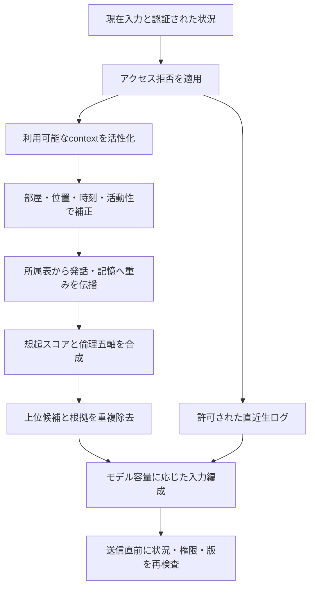

# Hippocampus 新正規DB・文脈想起・学習パイプライン実行計画書

改訂日：2026-09-24 / 改訂2
状態：計画のみ。実装、DB作成、学習実行、設定変更は未実施。
本改訂は旧版の移行・互換方針を置き換える。以下では、今回指定された要件を「確定方針」、詳細化のために置いた値や手順を「設計案」と区別する。

## 1. 確定方針と改訂の範囲

**新仕様の正規DBを空の状態から新規構築し、全システムの完成後に、Raw対話ログと別途用意されたログファイルから初期学習を行う。** Hippocampusの旧DB・現行V0.2DBのデータは使用しない。

| 項目 | 改訂後の方針 |
|---|---|
| 発話識別 | 主キーは既存命名の `records.id` / 入出力オブジェクトの `id`。参照は既存命名の `event_id` または `{id, version}` を使う |
| 同義の識別子 | 同じ発話に別名の `utterance_id` を追加する旧案を撤回。別の発話ID体系や対応表を作らない |
| 既存DB | 今後は内容の参照、照会、再集計、更新、schema変更、移行元利用を行わない。コピーやbackupを経由した取り込みも行わない |
| 設計参照 | V0.2のソース上のschema・型・命名・設計資料を参照対象とする。実DBを開いてschemaや内容を再確認しない |
| 旧API | 試作段階の互換経路として保守・機能追加・仕様変更の対象外。新実装から呼ばず、fallbackも行わない |
| 後方互換性 | 旧DB・旧API・旧scope・旧pathとの互換性を要求しない |
| 新DBの初期データ | 指定されたRawログを共通パイプラインで正規化・解析・検証した結果から作る |
| 実データを使う時期 | 全システム完成・架空データによる受入試験後に初期学習を開始する |
| 学習処理 | 初期学習と日次学習は同じ処理モジュール、解析ロジック、解析プロセス、出力形式を使う |
| モデル | 通常対話モデルを既定とし、ユーザーがUIから別モデルを指定できる |
| 時刻品質 | `exact` / `estimated_uniform` / `approximate_range` / `unknown` の四値に統一 |

旧版にあった既存DBの件数・接続先・移行手順・互換層・旧APIとの比較試験・旧DBへの切戻しを、実行計画から除外した。命名の再利用は既存レコードのID値・データ・監査履歴の再利用を意味しない。

今回編集した対象は本計画書のみ。旧DB・現行DBは開いておらず、Rawログの読み取り・初期学習・日次学習も実行していない。

## 2. システムの構成と責任

新システムは次の構成とする。

1. **Rawログ保管領域**：ユーザーが指定したファイル、および新システムが収録する入出力を原形のまま保持する。
2. **共通学習パイプライン**：範囲確定、対話列正規化、モデルによる意味要約・記憶抽出・文脈所属付与を行う。
3. **staging領域**：解析結果と根拠、時刻推定、検証結果を保持する。通常想起からは参照しない。
4. **新正規DB**：検証済みの発話、記憶、文脈、状況、倫理評価、アクセス方針を保存する。
5. **想起・入力編成**：現在入力と状況から文脈を活性化し、生ログと必要な記憶を編成する。
6. **UI・観測・運用**：モデル選択、学習範囲指定、進捗、時刻訂正、日次履歴、検索、部屋操作を提供する。

ここでの「学習」は、モデルによる解析結果を記憶・要約・文脈マップとして構築・更新する処理を指す。モデル重みのファインチューニングは本計画の対象に含めない。

### 2.1 Rawと正規発話の関係

Rawは学習入力と出典、`records(kind=event)` は正規化した発話の正本とする。Rawの元文字列と正規化後の内容を区別し、出典参照とdigestで対応を説明できるようにする。モデルが原発話を言い換えて正規発話へ保存することは禁止する。

新システムのライブ対話では、Raw収録と発話保存を先に行い、意味要約等を日次処理に回せる。日次処理が同じRawから発話を正規化しても、同じ `id` と一致することを検証して再利用し、発話を重複登録しない。

既存の独立したRawログは入力にできるが、Hippocampusの旧DB・現行DBからRawを取り出す経路は作らない。どのファイル／収録元を入力にするかは、学習実行時の入力manifestで明示する。

### 2.2 スレッド非依存の正規設計

新APIの発話保存・想起で `conversation_id` を必須にしない。ログファイル名、スレッドタイトル、元セッションは出典・入力範囲の手掛かりとして保持し、想起の境界にはしない。

`principal_id` は所有者、`context_id` は意味的文脈、room等は状況、`turn_id` は入力と対応応答の表示・処理単位、`sandbox_id` はfiction等の利用境界とする。旧 `context_key` や旧pathの意味・形式を新仕様へ引き継ぐ互換層は作らない。意味的な所属は常に別テーブルに置く。

## 3. 初期学習と日次学習の共通パイプライン

### 3.1 確定フロー

**初期学習**

```text
Rawログ
→ 範囲指定
→ 対話列正規化
→ 通常対話モデル、またはUI指定モデルによる
   意味要約・記憶抽出・文脈所属付与
→ staging
→ 検証
→ 新正規DB投入
```

**日次学習**

```text
前回日次処理末端から最新の処理起点までのRawログ
→ 同じ対話列正規化
→ 同じモデル解析モジュールによる
   意味要約・記憶抽出・文脈所属付与
→ 同じstaging形式
→ 同じ検証
→ 新正規DBへの差分更新
```

日次入力がすでに正規化済みの収録形式でも、共通正規化処理による検証を通す。日次だけでrole変換、時刻処理、根拠判定を省略しない。

初期／日次で変えてよいものは、入力範囲の選択方法、初期公開か差分公開か、checkpointの管理、ユーザーが指定するモデル設定である。解析本体に初期用・日次用の別実装を持たせない。同一の入力manifestと設定なら同じ解析手順・出力schemaを適用する。生成モデルの出力が常にbyte単位で一致するという保証とは区別する。

### 3.2 範囲指定と入力manifest

初期学習UIではファイル／セッション単位、発話 `sequence` の区間、根拠のある日時・期間条件を指定できる。日付不明のログもsequenceで選択可能にする。

解析開始前に、次をmanifestへ固定する。

- 対象のRaw source、原ファイル名、内容digest、形式、所有者。
- 処理対象のsequence区間と入力snapshot。ファイル名だけを一意な識別子にしない。
- 必要に応じて前後の読解用範囲。書込み対象と `context_only` の読解範囲を区別する。
- 正規化schema、時間解釈policy、timezoneとその指定元。
- 解析モジュール、prompt、出力schema、文脈体系のversion。
- 実際に解決されたモデル、provider、モデル版情報、生成設定、tokenizer／容量情報。

指定範囲外の発話を、推測で処理済みにしない。入力ファイルが途中で変わった場合は、固定済みsnapshotで続行するか新しいmanifestで再実行し、同じjobの入力を差し替えない。

### 3.3 モデル選択と解析

UIでは「通常対話モデルを使用」を既定とし、利用可能な別モデルを指定できる。job作成時に実際のモデルを固定し、その後の通常対話モデルの変更を進行中jobへ混入させない。

モデル、prompt、解析ロジック、チャンク分割方針は初期／日次共通である。容量に応じてuserと応答群の関係を保ちながら分割し、読み取り範囲の重なりがあっても出力対象を重複させない。大きすぎる単一turnは明示的な分割・階層処理方針で扱い、無通知で本文を切り捨てない。

モデルは次を**提案**する。

- 原文参照に結び付いた意味要約、エピソード、構造化記憶候補。
- 既存contextへの所属と重み、新しいcontextの候補。
- 根拠となる `source_event_ids` と、必要な原文span／版／digest。

モデルは発話ID、元の発話順序、事実時刻、所有者、アクセス許可、世界の真偽評価を自由に書き換えない。文脈候補はstaging内の候補参照から検証済み `contexts.id` に解決する。生成テキストをFKなしのcontext名として正規投入しない。

選択モデルが使えない場合はjobを失敗または再試行待ちにする。別モデル、旧API、旧DBへ自動fallbackしない。ユーザーがモデルを変更して再実行する場合は、新しい実行manifestを記録する。

Rawやstagingにも正規DBと同等のアクセス区分と利用先制約を適用する。モデルへ送信する前に、その処理主体と送信先が対象ログを扱えることを確認する。学習用モデルへ送信してから出力だけを除外する方式にはしない。

### 3.4 共通出力形式

両モードとも、同じversionの出力envelopeに次を格納する。具体的な型名・配置は契約確定工程で決める。

| 出力要素 | 内容 |
|---|---|
| manifest参照 | 入力snapshot、範囲、model／prompt／pipeline版 |
| 正規化発話 | `id`, `role`, `content`, `sequence`, 出典、時刻情報。モデルが生成した原文ではない |
| 要約・記憶候補 | 本文、種類、原文参照、未評価状態、後継候補参照 |
| context候補 | 名称・説明・根拠。既存IDとの照合結果 |
| 所属候補 | `event_id` または対象記憶参照、`context_id`／staging内候補参照、重み、source |
| 時刻解釈 | 四値のtime_quality、元時刻、推定方法、精度・誤差、範囲／相対offset |
| 検証結果 | error / warning / 要確認、対象範囲、検証器のversion |
| 書込み提案 | 追加、既存一致、後継追加、競合。DB命令文そのものは出力させない |

stagingのレコードを通常の記憶として取得する経路は設けない。失敗した解析結果や未検証の文脈所属は、検索・入力編成へ混入させない。

### 3.5 検証と正規投入

構文・型検査の後、所有者、アクセス範囲、FK、重複、原文digest／span、role帰属、sequence、時刻品質、所属重み、参照版を検証する。構造検証だけで要約の意味的な正しさが証明されたことにはしない。忠実性の検査と要確認の表示を設け、裏付けのない主張は未評価の候補として扱う。

通常の有効な解析結果は検証後に投入できる契約とする。全件に手動承認を必須にはしない。競合、解釈不能な時刻、アクセス公開範囲の拡張等は別の確認／review経路へ回す。自動的に検証errorを修復して成功扱いにしない。

正規投入は、発話の一致確認／登録、要約・記憶、context解決、所属、時刻履歴、監査、冪等receipt、処理済み範囲をtransactionで整合させる。モデルにDBへの直接書込みをさせない。

原文は不変、時刻の解釈・要約・所属は版管理する。再解析は同じ発話IDを使い、派生物の新しい版やmap世代を作る。文字列が同じ別の発話を本文hashだけで重複排除しない。

## 4. 入力ファイルと対話列正規化

### 4.1 受入形式

ファイル名はスレッドタイトルまたはセッションID。本文はJSONオブジェクトとし、UTF-8を基本とする。原ファイル名と元byte列を保持し、表題から日時・所有者・文脈を事実として推定しない。

共通の `messages` は順序を持つ配列とする。各要素の `role` と `text` を、正規形の `role` と `content` へ変換する。`agent` は `assistant` へ対応させ、元のrole文字列は出典に残す。配列位置から1始まりの `sequence` を付け、発話順序を保存する。

user／agentの交互発話は時刻推定例の前提であり、入力検証で強制しない。連続user、複数assistant、tool、system等は別途定めるrole契約で処理し、交互にするための架空発話を挿入しない。未知のroleは黙ってuserやassistantへ変換せず、検証対象とする。

ご提示例2の `=`、例3のdatetime直後のカンマ省略は、仕様説明上の表記として扱う。実入力は正しいJSONを要求する。構文不正をLLMが無断修正して原文として投入する経路は作らない。

### 4.2 有効なJSONの最小例

以下の本文は形式検証用の架空の短文である。

**例1：開始日時と総時間がある**

```json
{
  "session_start_datetime": "2026/03/07 18:56",
  "total_session_time_minutes": 30,
  "messages": [
    {"role": "user", "text": "架空の入力1"},
    {"role": "agent", "text": "架空の応答1"},
    {"role": "user", "text": "架空の入力2"},
    {"role": "agent", "text": "架空の応答2"}
  ]
}
```

**例2：おおよその期間だけがある**

```json
{
  "approximate_period": "2026/03/上旬頃 夜",
  "messages": [
    {"role": "user", "text": "架空の入力1"},
    {"role": "agent", "text": "架空の応答1"},
    {"role": "user", "text": "架空の入力2"},
    {"role": "agent", "text": "架空の応答2"}
  ]
}
```

**例3：各発話の日時がある**

```json
{
  "messages": [
    {"datetime": "2026/03/07 18:56:27.000", "role": "user", "text": "架空の入力1"},
    {"datetime": "2026/03/07 18:56:48.510", "role": "agent", "text": "架空の応答1"},
    {"datetime": "2026/03/07 18:59:07.950", "role": "user", "text": "架空の入力2"},
    {"datetime": "2026/03/07 19:00:01.000", "role": "agent", "text": "架空の応答2"}
  ]
}
```

`total_session_time_minutes` を正規の入力キーとし、単位は分とする。総時間不明はキー省略、null、文字列 `"unknown"` を受け入れて同じ「不明」へ正規化する案とする。負値、真偽値、NaN、無限大、未定義の単位は受け入れない。別名の同義キーを追加しない。

timezoneは入力に明示されたもの、またはUIで指定した取り込みtimezoneを使用し、元の指定情報を保存する。例の日時文字列自体にはtimezoneがないため、機械のローカル設定から無断確定しない。夏時間等の曖昧な日時は解決を要する状態として扱う。

## 5. 時刻品質・推定・訂正

### 5.1 時刻と順序を分離する

発話は入力／出力時の時間情報を持つが、不明な場合に正確な点時刻を強制しない。`event_time` はnullを許容する。`sequence` は常に保持し、推定時刻の修正によって入れ替えない。

`created_at`／受領時刻はシステムに保存した時刻であり、発話時刻の代用品にしない。初期学習の実行時刻を、過去の会話の発話時刻として保存しない。

ライブ収録では、user入力を受け付けた時点とassistant出力が完了した時点を初期の計測点案とする。ストリーミング開始等も必要なら別の計測事実として保存し、計測点と精度を明記する。モデル処理時間から入出力時刻を逆算しない。

### 5.2 四値の契約

| `time_quality` | 意味 | `event_time` | その他の保持内容 |
|---|---|---|---|
| `exact` | 原ログ／新収録に、その発話の時刻が記録されている | 原時刻をtimezone・精度付きで正規化した値 | 元文字列、出典、計測点、元精度。exactは「記録された事実」を表し無限精度を意味しない |
| `estimated_uniform` | 開始日時と既知の総時間から等間隔推定 | 推定した絶対日時 | 開始／総時間の根拠、計算式・policy版、推定精度、誤差不明の表示 |
| `approximate_range` | おおよその期間だけが分かる | **null** | `approximate_period`、解釈可能なら暫定期間、sequence、必要に応じ相対offset |
| `unknown` | 発話に対応する点時刻・期間を推定できない | **null** | sequence。分かるセッション情報はセッションの出典metadataへ保持 |

日時が秒未満まであるなら元の桁精度を維持する。分単位しかないexact時刻に、実測した秒・ミリ秒があるかのような精度を与えない。正規化表現の秒ゼロと、実際に秒ゼロだったという事実を区別する。

### 5.3 例1：開始日時＋既知の総時間

確定要件は「等間隔推定」「品質はestimated_uniform」「総時間不明なら推定しない」である。等間隔の端点の定義には、次の**設計案**を置く。

```text
N = 対象セッション全体の発話数
D = total_session_time_minutes × 60秒
k = sequence - 1
N >= 2：relative_offset_seconds = k × D / (N - 1)
         event_time = session_start_datetime + relative_offset_seconds
N == 1：relative_offset_seconds = 0
         event_time = session_start_datetime（開始点への配置という推定）
```

先頭を開始点、末尾を総時間経過点に置く。例1の4発話・30分では、取り込みtimezoneをUIで確定した後、18:56、19:06、19:16、19:26となり、**先頭を含め全件estimated_uniform**とする。セッション開始が分かっていても、その瞬間に先頭発話があったことまでは確定しないためである。

丸め方法と計算精度をpolicyに固定する。発話数0の入力は解析対象にしない。総時間0を認める場合は同時刻の推定となり、sequenceで順序を保つ。

範囲指定でセッションの一部だけを学習しても、等間隔計算は元のセッション全体の発話数と元sequenceを使う。選択した一部分へ総時間を再配分して時刻が変わる設計にしない。

総時間が不明なら、開始日時はセッションmetadataとして残し、各発話のevent_timeはnull、time_qualityはunknownとする。2分間隔の代替推定は行わない。明示された個別datetimeがある発話は、その事実を優先できる。

### 5.4 例2：おおよその期間のみ

末尾のご指定を優先し、**具体的な絶対日時を作らない**。`approximate_period = "2026/03/上旬頃 夜"` を保持し、全発話を `approximate_range` とする。

例中の「2分間隔」は次の相対的な配置に限定する。

```text
event_time = null
relative_offset_seconds = (sequence - 1) × 120
relative_offset_basis = assumed_two_minutes
```

4発話なら0秒、120秒、240秒、360秒。絶対日時の起点を持たず、3月1日や3月7日、夜の任意時刻へ接続しない。この6分という幅も仮の配置であり、実際の総セッション時間として保存しない。

`approximate_period` の元表現を必ず残す。「上旬頃」「夜」を検索用期間へ解釈する場合は、解釈方法・policy版・曖昧さを付けた範囲情報として別に保存する。範囲内の一点を事実時刻へ変換しない。範囲解釈ができなくても元表現とsequenceで保存できるようにする。

### 5.5 例3と混在入力

各発話のdatetimeを原記録として保存し、timezoneを解決した上で `exact` にする。例3の元時刻は18:56:27.000、18:56:48.510、18:59:07.950、19:00:01.000であり、等間隔処理にかけない。

混在時は、個別datetimeのある発話を優先する。その他の発話は、開始＋総時間、概略期間、不明の条件に応じて決定する。既知のexact時刻と等間隔推定が矛盾する場合は警告／要確認にし、exactを推定値で上書きしない。exact点の間を補間する別方式は、初期仕様へ暗黙に加えない。

原ログの時刻順がsequenceと逆転していても、時計ずれや元記録の可能性を残し、並べ替えて原文の順序を変えない。

### 5.6 保存項目と訂正

時間解釈は原発話と独立に版管理する。元文字列と元の精度はRaw出典に固定し、初期学習が生成した推定値は時間解釈レコードへ保存する。

| 項目 | 内容 |
|---|---|
| `event_id` | 既存命名を使った `records.id` への参照 |
| `event_time` / `time_quality` | 現在採用する点時刻と四値の品質 |
| 元時刻への参照 | Raw内のdatetime／セッション開始／期間記述の位置とdigest |
| `timezone` | 解釈に使用したtimezone、元の指定／UI指定の別 |
| `approximate_period` | 元の概略期間表現。点時刻に変換しない |
| 範囲情報 | 必要なら開始・終了、解釈方法、範囲の曖昧さ。unknownはnull |
| `relative_offset_seconds` | 相対位置。uniformまたは2分仮置きの方法を別記 |
| 推定方法・版 | none / uniform_session / assumed_two_minutes / period_parse等 |
| 元精度・推定精度・誤差 | 分／秒／ミリ秒、粗い推定、範囲のみ、不明等。誤差不明はnullであり0にしない |
| 改訂の来歴 | version、前版参照、根拠、訂正者、理由、作成時刻 |

estimated_uniform／approximate_range／unknownは、後から確かな時刻が得られたら訂正できる。新しい時間解釈を追記して現在版を切り替え、原文、`records.id`、sequence、元ログ、過去の推定値は変えない。exactの自動的な再推定・降格は行わない。原記録自体の誤りの訂正が必要な場合は、根拠付きの明示reviewとして別に扱う。

訂正後は日付索引、期間検索、時間に依存する要約・想起結果を再評価する。古い要約の「昨日」等を黙って新しい日付として解釈せず、依存する時間版を記録して失効／再生成対象にする。日次処理位置はevent_timeでなくRawのsequenceで管理するため、時刻訂正で処理済み位置が動かない。

## 6. 新正規DBの設計

### 6.1 命名・正本・監査

発話の正本は新DBの `records`、主キーは `id`、発話種別は `kind=event` とする。APIでも発話オブジェクト自身は `id` を使い、FKや関連づけには既存の `event_id`、複数根拠には `source_event_ids`、版付き参照には `{id, version}` を使う。

発話自身の `id` を別の名前でも保持する1対1の表は作らない。旧案の発話別名用 `utterances` 表を撤回する。時間解釈、所属、Raw source等のIDは、それぞれ別の実体を識別するものであり、発話の別IDではない。

本文の正本、時間解釈の正本、所属の正本を分ける。正規化発話と現在時刻を返すAPIは時間解釈の現在版を結合し、書込み可能なevent_timeを発話本文側にも重複保持しない。日付索引用の投影は再構築可能な派生データとする。

新DBには新しいschema version、監査epoch、署名・backup領域を設ける。既存V0.2の番号・監査履歴・鍵・checkpointを継承しない。すべての新正本を監査対象にし、冪等性、期待version、FK、監査を一つの書込み契約にまとめる。

### 6.2 学習・原文・時間の表

以下はテーブル名と主要列の設計案。共通の所有者、作成時刻、version、監査列は必要に応じて追加する。

| 表／保管単位 | 主要項目 | 役割 |
|---|---|---|
| `raw_sources` | `id`, 元ファイル名／収録元, 内容digest, 形式, 所有者, 原本参照 | 許可されたRaw入力の登録。原本の変更は新revisionとして識別 |
| `raw_log_messages` | `source_id`, `sequence`, 元role／本文／時刻metadata, digest | 入力元内の順序と原形。主キーはsourceとsequence等で定義 |
| `learning_runs` | `id`, mode, manifest, model設定, pipeline版, 状態 | 初期／日次の同一実行契約 |
| `learning_batches` | `id`, run参照, 範囲, 入力digest, 状態, receipt | 分割実行と再試行の単位 |
| staging各表 | batch参照, 共通出力, 提案参照, 検証結果 | 未採用の解析結果を隔離 |
| `learning_checkpoints` | owner／source, 最終commit済みsequence, version | 日次の差分位置。初期学習完了時にも連続範囲を引き継ぐ |
| `records` | `id`, `kind`, `principal_id`, `data_json`, `version` 等 | 正規発話、記憶、要約、実行観測等の正本 |
| 発話の出典関連 | `event_id`, `source_id`, `sequence`, source digest | Rawと正規発話の対応。同じログの再投入時の照合 |
| `event_time_revisions` | `id`, `event_id`, time_qualityと第5章の項目, 前版参照 | 時間情報の不変履歴 |
| `event_time_heads` | `event_id`, 現在の時間解釈参照, version | 時刻訂正の現在版 |
| 発話検索用投影 | `event_id`, `event_time`, `time_quality`, 期間情報, source／sequence | 日付・期間索引。別の発話IDは生成しない |

Rawのsourceとsequenceの対応により一度割り当てた発話 `id` を再利用する。本文が同じでも別位置の発話なら別IDである。別ファイルに同じ原発話が重複している場合、元message ID等で証明できる範囲だけを統合し、不確かな一致は候補として残す。

発話が入力元から訂正された場合は内容版を追加し、元の内容と出典を保存する。時刻訂正だけでは内容版・発話IDを作り直さない。

### 6.3 文脈と所属

| テーブル | 主要列 | 役割 |
|---|---|---|
| `contexts` | `id`, `principal_id`, name, description, status, access_scope, version | 文脈の実体。表示名と不変IDを分離 |
| `context_map_generations` | `id`, owner, 入力manifest, 分類model／policy版, 対象範囲, 状態 | 再生成単位と再現情報 |
| `context_map_heads` | owner, 採用generation参照, version | 一貫した所属マップの公開 |
| `utterance_context_membership` | `id`, `principal_id`, `generation_id`, **`event_id`, `context_id`, `membership_weight`, `source`, `assigned_at`** | 発話の多対多所属。表名は前提案を維持し、参照名は既存命名を再利用 |
| `memory_context_membership` | `id`, `principal_id`, generation, `memory_id`, `target_version`, `context_id`, 重み, source, assigned_at | 記憶・要約・episode・知識の所属 |

制約：

- `event_id → records.id`、`context_id → contexts.id`、generation参照に実FKを置く。発話の参照先はkind=eventに制限する。
- 所有者を含む複合FK／UNIQUEとkind検証を使い、別principalや別種のrecordとの誤結合を拒否する。
- 一つの有効世代内で `(principal_id, generation_id, event_id, context_id)` を一意にする。memory側は対象版も含む。
- 所属重みは有限の `[0,1]`。一つの発話の所属合計は1に制限せず、0.8と0.3の重なりを保持する。
- 所属confidenceはmembership_weightと別に扱い、未評価はnullとする。
- sourceにはmanual、model_extraction、inherited等の管理値と根拠参照を持つ。旧DB移行をsourceにしない。
- 分類器やmodelを変更しても、原文・記憶本文を変更せずmap世代を再生成できる。
- 手動確定を優先し、複数modelの同じ組への重みを単純加算しない。日次差分で既存の手動指定を消さない。

contextのIDは不透明な文字列でもよいが、自由記述の文脈名だけをFKの代わりに使わない。modelが提案した新contextは重複・所有者・定義を検証して登録し、そのIDへ所属を解決する。

初期学習では最初の有効な文脈マップを構築し、日次学習では同じ出力形式から対象発話・記憶の差分を反映する。mapの版は全体snapshotまたはbase世代＋deltaで表せるが、読み手には一つの一貫した採用世代として見せる。生成途中を公開せず、対象外の所属を失わない。

### 6.4 状況による活性度補正

| テーブル | 内容 |
|---|---|
| `rooms` | 仮想部屋のID、所有者、名称、状態 |
| `situation_events` | surface／端末、room、物理場所、時刻、活動性、audience、入力元、信頼度、有効期限 |
| `current_situations` | 利用面ごとの現在状況とrevision |
| 発話・状況の関連 | `event_id` と situation参照。発話時に観測した状況を保持 |
| `context_activation_modifier` | condition_type、condition_value、context_id、modifier、有効期間、優先順位、version |

`context_id` は実FK、room等の参照値も型付きで検証する。条件値を任意コードとして評価しない。room=REN作業場でREN contextに+0.6、深夜で業務contextに-0.3等を表現する。

部屋、物理位置、時間帯は別の入力とする。時間条件にはtimezoneを持ち、複合条件のAND／OR、同一規則の一回適用、失効、加算上限をpolicyで定義する。複数端末の現在状況を一つの値で上書きしない。

初期学習するログにroomや位置がなければunknownのままにする。意味内容から推測した場所は推定として別に扱い、当時の観測事実やアクセス許可に昇格させない。概略の会話時刻を現在の認可判断へ流用しない。

### 6.5 倫理評価の五軸

`context_ethical_weights`、`ethical_situation_adjustments`、必要に応じた `record_ethical_weights` に、以下を独立に保存する。

| 軸 | 意味 |
|---|---|
| `privacy_resistance` | 私的情報を近づける抵抗 |
| `harm_resistance` | 害につながる関連づけへの抵抗 |
| `social_context_resistance` | 場所・相手・社会的状況との不適合 |
| `identity_sensitivity` | 人物や自己同一性に関する繊細さ |
| `external_output_resistance` | 外部へ向けた出力へ反映する抵抗 |

各軸と状況deltaは有限の `[-1,+1]` を初期案とし、正は抵抗、負は緩和とする。未評価nullと評価値0は区別する。合成前の五軸、適用規則、係数、寄与を残し、単一modifierへ潰さない。

既存命名の `caution_gain`、`retrieval_weight`、`salience`、真偽評価、分類confidenceとは区別する。学習モデルによる所属付与が、倫理値の恒久変更やアクセス権の変更を自動的に許可することはない。

### 6.6 絶対拒否

`record_access_policies` にrecord参照、owner、`access_scope`、policy版、根拠、変更履歴を持つ。文脈やRaw sourceにもアクセス方針を付ける。

| scope | 初期の運用案 |
|---|---|
| public | 許可された共有利用面で利用可能。これだけで別principalへの共有は成立しない |
| personal | 本人の認証済み対話向け。guest・共有公開出力へ渡さない |
| private | 本人の信頼された私的利用面に限定 |
| restricted | 通常の検索・閲覧・想起・抽出・モデル入力を拒否 |

初期投入するRawの方針未設定時はprivateを初期案とし、自動public化しない。派生要約・記憶は根拠のうち最も厳しい制約を原則として継承する。共有用の別派生物を作る場合は、独立した明示reviewを要する。

拒否は所属重み、負の倫理抵抗、語句一致、直近生ログ優先でも解除できない。ID取得、検索件数・snippet、カレンダー、export、staging、学習model、run／receipt、観測feed、キャッシュ、hostが保持するmessages・tool結果へ一貫して適用する。

時刻訂正・部屋移動・利用者交替・方針変更で有効性が変わったrunは、送信直前に再検査して再編成する。通常APIの管理権限だけでrestricted本文を取得できる経路は設けない。バックアップ等の管理面は通常の内容参照APIから分離する。

## 7. 日次差分・再実行・公開の整合性

### 7.1 日次処理範囲

「前回日次処理末端から最新の処理起点まで」を、次のように定義する。

```text
L = 前回までに正規DBへcommit済みの連続したRaw末端
U = 今回のjob開始時に固定した、確定済みRawの末端
今回対象 = (L, U]   ※sourceごとにsequenceで管理
```

発話時刻や処理開始の壁時計時刻をcursorにしない。複数sourceでは `(source_id, sequence)` の集合をcheckpointとし、source間に架空の時系列を作らない。今回の処理中に追加されたRawは次回対象とする。

出力途中のassistantを確定済み発話として取り込まない。完了／中断等の収録状態を確定させてからUへ含める。時刻が古い遅延到着ログも新たなRaw sequenceとして検出でき、日時が古いという理由で取りこぼさない。

初期学習が日次対象sourceの先頭から連続範囲を処理した場合、そのcommit末端を日次の開始位置にできる。任意の途中範囲しか処理していない場合は、未処理部分を飛び越えてcheckpointを最大sequenceへ進めない。処理区間の台帳で欠落を検出する。

### 7.2 冪等性と途中失敗

入力source・範囲・digest・解析契約・model設定から実行を識別し、batchごとにreceiptを持つ。同一staging結果のcommit再送は新規発話・記憶・所属を重複させない。再試行は保存済みの検証済み結果を利用でき、意図的な再生成は別実行として履歴を残す。

一つのcommit単位では、正規データ、map差分、監査、receipt、処理済み区間を同じtransactionで確定する。checkpointはcommit済みの連続範囲だけ前進する。範囲途中で失敗したbatchがあるなら、後続だけ成功していてもその穴を越えて進めない。

検証失敗やモデル停止でRawを削除せず、stagingに失敗状態と理由を残して再開できるようにする。競合した記憶本文を「最後に返ったmodel結果」で上書きしない。新しい版・後継・置換候補として処理する。

### 7.3 初期公開と運用中更新

初期学習は大規模であり、batch単位の安全なcommitを許す。ただし、選択した初期範囲全体の検証・整合性確認が終わるまで、その初期releaseを通常想起へ公開しない。未完了と利用開始可能を明確に区別する。

日次学習は検証済みの連続batchを差分公開できる。job全体が途中失敗した場合も、どこまでcommit・公開済みかを表示する。公開済みの記憶や手動所属を空の解析結果で消さない。

時刻訂正やmodel変更による再解析は通常の日次cursorとは別の再処理queueとし、同じ共通解析モジュールへ渡す。日次cursorを巻き戻して関係のない全ログを再登録する方式にはしない。

## 8. 想起・継続生ログ・対話温度

### 8.1 想起の手順



候補は語句検索、活性contextからの所属検索、必要なグラフ探索の和集合から得る。語句一致を必須にして部屋による想起を無効にしない。分類器へ渡すcontext名や説明も認可対象だけにする。

初期の合成案：

```text
A(context) = clamp(入力関連度 + 部屋基準値 + 状況補正 + 減衰した前回活性度, 0, 1)
C(item) = bounded_sum(A(context) × membership_weight(item, context))
E_axis(item) = clamp(対象／文脈の基準値 + 状況delta, -1, 1)
score(item) = 校正した基礎想起スコア + context_gain × C(item)
              - Σ(axis_gain × E_axis(item))
```

所属重みを保存時に合計1へ正規化しない。集約には飽和上限を置き、多数のcontextへ所属するだけで無制限に加点されないようにする。同一根拠の重複要約・複数所属による二重加点も抑える。

各倫理軸は明示された対象個別値を優先し、それがなければ活性度×所属重みで文脈別値を集約する案とする。未評価fallback、係数、合成順をpolicyへ固定し、寄与をrunに記録する。倫理的な抑制とアクセス拒否は別理由として表示する。

現在状況の時間は信頼された時計から得る。記憶のrecency計算ではtime_qualityを考慮し、approximate_rangeやunknownに仮の点時刻を与えない。範囲を扱える計算、または時間成分未評価の扱いを採用し、恣意的な中央値や取り込み日時で新しさを偽らない。

### 8.2 約12.5k tokenの生ログ継続

`recent_raw_token_budget` の仮値を12,500とし、モデル・機材・実験結果に応じて変更可能にする。DB保存量、学習処理範囲、UIの2チャンク上限とは別の設定である。

system、現在入力、tool定義、出力予約を確保し、残容量へ生ログと想起記憶を編成する。発話 `id` で重複を除き、user／assistant対応とtool呼出し／結果を保つ。token数は実測／推定を区別し、超過時に本文や関係を黙って切らない。

通常のroom移動では、contextの変化だけを理由に直近生ログを消さない。guest切替や公開先変更では、生ログにもアクセス拒否が優先する。12,500 tokenをあらゆる状況で必ず保持する保証にはしない。

### 8.3 対話温度と経験の保存

対話温度は親しみ方、形式性、長さ、テンポ等の許可された非内容的な状態とする。sampling temperatureとは区別する。`interaction_style_state` は数値／列挙値を基本とし、私的エピソード、固有名詞、関係の説明文を保持しない。

guestへ渡すのは共有を許可したスタイル成分だけである。ownerのmessages、未送信packet、表示キャッシュ、継続推論セッションを引き継がず、許可済みの入力から構成し直す。

経験を残すことと、それを今参照できることを分ける。ownerの経験はownerのscopeで、guestの対話はその主体とscopeで保存し、スタイル共有を理由に原文や記憶を統合しない。

## 9. 履歴・日付検索・将来UI

### 9.1 不確かな時刻を含む全履歴

全履歴は、アクセスを許可された保存済み全発話へ到達できるものとする。想起の上位結果や学習対象に採用された要約だけを表示する画面にはしない。

| 品質 | 履歴／カレンダーでの扱い |
|---|---|
| exact | 元精度を示して日時で配置する |
| estimated_uniform | 推定ラベルと方法を示して推定日時へ配置する。事実時刻とは区別する |
| approximate_range | 概略期間のまとまりとして表示し、内部はsequence順。仮の一日・時刻へ割り振らない |
| unknown | 日付未確定の一覧から到達可能にし、source内のsequence順を保つ |

期間しか分からない／日付不明の発話を含むため、全ログの唯一の厳密な時刻順は定義できない。確かな部分の時系列とsource内の発話順を保ち、曖昧な部分を曖昧なまま見せる。「日付を付けられないため表示しない」という欠落は許容しない。

訂正UIでは、元の記述、現時点の解釈、time_quality、推定方法、精度／誤差、履歴を確認できる。訂正時は根拠と期待versionを送り、別の訂正を上書きしない。

### 9.2 日次ロードと検索

点時刻を持つ発話は、選択日とtimezoneから求めた半開区間 `[日開始UTC, 翌日開始UTC)` でロードする。一日が大量の場合は日内でもページングする。timezone変更や夏時間にも対応する。

概略期間の検索は「この期間と重なる可能性がある」という別種の一致を返す。正確な当日件数へ混ぜず、exact／estimated／rangeを区別する。同じ概略セッションを各日に別件として複製表示しない。unknownは日付未確定の検索経路で全件に到達できる。

カーソルには検索条件、timezone、保存snapshot、時間解釈revision、必要ならmap generation、認可policy revisionを結び付ける。時刻訂正で日付索引が変わったときは、古いカーソルを失効させて再読込する案を基本とし、無通知の重複・欠落を避ける。アクセス縮小はsnapshotより優先する。

日付一覧には認可された情報だけを返す。全体検索は文字列、role、source、sequence、時刻品質、日付／期間、context、所属重み、room、版等を組み合わせられるようにする。取得上限には続きのcursorと完全性の情報を付け、最古ログ・日付未確定ログまで到達できるようにする。

日本語検索は分かち書きのない部分一致も検証する。FTSと必要な補助索引は架空データで比較して選ぶ。DB移行元として旧検索結果を使わない。抽出は検索snapshotに沿った全件取得を可能にし、途中終了を完了と表示しない。

### 9.3 UIの2チャンクと学習の処理単位

表示の1チャンクは、暫定的に1 user turnと対応するassistant応答群とする。`dialogue_turns` と、既存命名の `event_id` を使う対応表で関係を保持する。複数応答・再生成・toolを一対一に押し込めない。

入力欄上は直近最大2turnとし、非表示操作はフロントエンドの表示設定へ記録する。原文削除、所属変更、学習対象除外、アクセス権変更にはしない。非表示によって古い私的turnを自動で繰り上げ表示しない。

学習modelへ渡すチャンク、episodeの要約単位、UIの2チャンクは別の概念である。UIから消した発話も、認可と学習範囲の契約に従って保存・処理する。

## 10. 新API・UI・運用機能の実装範囲

以下は新規契約の候補であり、既存APIの変更要求ではない。新しいサービス／接続先として実装し、旧APIへルーティングしない。

| 機能 | API／UI候補 | 主な要件 |
|---|---|---|
| ライブ対話収録 | `POST /dialogue/events` | `id`、冪等キー、role、content、出典、実測時刻、turn、状況 |
| Raw登録と範囲選択 | `/learning/sources` | ファイル、digest、許可された範囲、sequence、timezone |
| モデル選択 | 学習job作成UI | 通常対話model／別指定。実行時設定をmanifestへ固定 |
| 初期／日次job | `/learning/runs` | modeごとの入力選択と共通解析契約。進捗・再開・失敗理由 |
| staging・検証 | `/learning/staging` | 共通出力、根拠、error／warning、要確認、検証版 |
| 投入・差分反映 | 学習commit command | 期待version、receipt、世代の一貫性、checkpoint |
| 時刻訂正 | `/dialogue/events/{event_id}/time-revisions` | 元記録と推定の分離、根拠、履歴、日付索引の更新 |
| 日次履歴・カレンダー | `/dialogue/timeline`, `/dialogue/days` | 点時刻／推定／期間／日付不明を区別 |
| 全体検索・抽出 | `/dialogue/search`, `/dialogue/exports` | 全認可ログ、cursor、snapshot、完全性 |
| context管理 | `/contexts`, `/context-maps` | FK、手動所属、model生成、世代切替 |
| 現在状況・補正 | `/situations`, `/context-policies` | 認証された操作、失効、複合条件、倫理五軸 |
| アクセス方針 | `/access-policies` | 専用権限、派生先の制約、古い入力・コピーの失効 |
| 想起 | `POST /context/runs` | 文脈・時刻・状況・認可の版、採用内訳、入力digest |
| 観測 | 新契約のfeed／Observatory接続 | 学習段階、想起理由、時刻品質、キャッシュ認可 |

学習用権限、通常対話、review、アクセス公開範囲の管理を分離する。原文やmodelの出力に命令が書かれていても、modelが自分の権限やAPIを変更できる契約にはしない。

新host、新UI、Observatoryは新契約へ接続する。旧APIの保守や互換試験を行うために既存のbridge／gatewayを改修する計画は撤回する。V0.2の純粋関数や命名を参考にする場合も、新DB・新契約だけで動作するかを検査し、旧接続先や暗黙のfallbackを持ち込まない。

日次実行の時間帯・手動実行・再試行等は新システムのジョブ管理機能として実装する。本改訂時点でスケジュールや自動実行は設定しない。

## 11. 段階的実行計画

### 11.1 開発と受入

| 段階 | 実施内容 | 完了条件 |
|---|---|---|
| P0：新契約の確定 | 既存DBの非利用、命名、Raw形式、四値の時刻品質、共通解析出力、認可、等間隔端点の定義 | 旧互換要件が混入せず、3種類の入力と訂正例を一意に扱える |
| P1：新規基盤 | 独立した新DB、Raw保管、staging、監査、時間版、context所属、学習台帳、backup／restore | 架空データでFK・版・監査・復旧・消去が成立 |
| P2：共通学習本体 | 共通正規化、UI指定model接続、意味要約・記憶抽出・所属付与、根拠照合、同一出力schema | 初期／日次が同じモジュールを呼び、同じ条件なら同じ解析手順を通る |
| P3：投入と日次差分 | staging検証、commit、冪等性、処理区間台帳、checkpoint、再実行、時刻訂正 | 途中失敗・遅延到着・部分範囲・訂正で欠落や二重登録を起こさない |
| P4：想起と拒否 | 文脈活性化、状況補正、倫理五軸、全入力の拒否処理、生ログ枠、対話温度 | アクセス拒否を保ち、文脈移動・容量・時間品質の効果を説明できる |
| P5：UI・観測・運用 | 2チャンク、部屋操作、学習範囲とmodel選択、日次履歴、日付不明一覧、検索、抽出、訂正、運用機能 | 新契約だけで一通り操作でき、staging／原文／派生物を区別できる |
| P6：全システム受入 | 全工程の結合、性能、権限、backup／restore、再開・消去、旧DB／旧API非依存を確認 | **新DB・学習・想起・UI・観測・運用の必須機能がすべて完成** |
| P7：初期学習と利用開始 | 初めて指定された実Rawログを使い、全範囲を共通経路で解析・検証・投入 | 初期releaseの完全性を確認し、日次の開始位置を確定して公開 |
| P8：日次運用 | 新Rawの差分処理、訂正・再解析、model／policy版の更新 | 学習履歴と差分位置を保ち、再処理の影響を追跡できる |

**実Rawログの初期学習はP6完了後のP7で行う。** 開発中は架空fixtureを使用する。modelによる意味要約・記憶抽出・所属付与は完成条件に含め、後続の任意拡張へ延期しない。

物理位置センサー、活動推定、embedding等の将来機能は接続可能な契約を設ける。今回の必須完成範囲に含める具体的な機器連携は、仕様が定まったものをP0で明記する。仮想roomと時刻だけで基礎機能を検証できる構成にする。

### 11.2 初期学習の実行手順

1. 完成した新システムに、独立した新正規DBとstagingを用意する。接続先は新環境だけに限定する。
2. ユーザーが指定するRawファイル／収録元、所有者、アクセス方針、対象範囲を登録する。Hippocampusの旧DB・現行DBは入力候補にしない。
3. timezone、時刻解釈policy、通常対話modelまたは指定modelをUIで設定する。
4. manifestを固定し、共通正規化・model解析を実行してstagingへ保存する。
5. 共通検証を行い、error・競合・要確認を解消する。原ログ・確定時刻の欠落を推測で埋めない。
6. 検証済みbatchをcommitし、処理範囲とreceiptを記録する。初期releaseは未公開のまま保持する。
7. 指定範囲の全件対応、時刻品質、FK、原文digest、監査、map完全性、権限、検索到達性を確認する。
8. 初期releaseを公開し、連続して処理できたRaw範囲だけを日次checkpointへ接続する。
9. 以後、同じ処理本体を日次の `(L,U]` 範囲へ適用する。

旧DBからのschema upgrade、dump／import、既存レコードのbackfill、既存監査epochの継承は行わない。旧サービスの設定変更や再起動を、この計画の新規構築手順に含めない。

### 11.3 失敗・切戻し・消去

失敗時は新環境内の未公開release／staging／学習batchから再開する。稼働中の新正規DBに既に新規発話がある場合は、それを失うsnapshot復元を通常の切戻しにしない。

通常の切戻しは新DB内の派生物・map世代・policy版を対象にする。旧DB・旧APIへ戻す運用は設けない。新DB自体を復元する場合は、新環境の署名backupと差分保全の手順を使う。

消去対象は正規記憶だけでなく、Raw、staging、時間改訂、所属世代、run／receipt、export、観測コピーまで定義する。所有者消去と、UIの非表示・再分類・時刻訂正を混同しない。

## 12. 受入試験と評価

以下は実装時の試験計画であり、今回コードやmodelを動かして検証した結果ではない。

| 分類 | 受入条件 |
|---|---|
| 既存資産への非接触 | 新実装の設定・依存関係・接続処理に旧DB／旧APIの利用がない。架空の禁止接続先で拒否を検証し、実際の旧DBを開いて試験しない |
| 命名 | 発話自身はid、参照はevent_id／source_event_ids／版付きid。発話の同義IDや別名対応表を持たない |
| 共通解析 | 初期／日次の共通入口・正規化・prompt構築・model呼出し・出力検証を契約試験で確認する |
| model選択 | default／UI別指定が反映され、途中の既定model変更がjobへ混入せず、失敗時に別modelへ無断切替しない |
| JSON正規化 | 有効な3例を受け付け、agent→assistant、text→content、sequenceを正しく変換。不正JSON・未知roleを無断補修しない |
| 例1 | 4発話・30分を端点案なら0/600/1200/1800秒へ配置し、全件estimated_uniformとする |
| 例1・時間不明 | 総時間欠落／null／unknownで各event_timeはnull、sequenceを保持。2分推定を適用しない |
| 例1・部分範囲 | 同じ発話を全体／部分選択したときに推定時刻が変わらない。N=1、N=0、総時間0、負値を契約どおり扱う |
| 例2 | approximate_range、event_time=null、元period保持。2分offsetは0/120/240/360秒で、絶対日時や事実の総時間を作らない |
| 例3 | 各datetimeとミリ秒精度を保存しexactとする。timezone未解決を無断確定しない |
| 品質・誤差 | exactの粗い元精度、推定の不明な誤差、期間のみ、不明を区別。不明誤差を0にしない |
| 時刻訂正 | 非確定値からexact等へ改訂でき、id・本文・sequence・元ログを変えない。時刻版依存の索引・要約・cursorを更新／失効させる |
| staging隔離 | 未検証・失敗・競合の候補が想起、日次履歴、モデル入力へ混入しない |
| 根拠 | 原文span／digest、版、role帰属、ownerを照合できる。意味要約を原発話へ置換しない |
| 日次範囲 | `(L,U]`、処理中到着、古い時刻の遅延到着、時刻訂正、source追加を欠落なく扱う |
| 再送・障害 | commit応答消失、再実行、途中batch失敗、競合で二重登録やcheckpointの飛越しがない |
| 初期公開 | 全システム受入前に実ログを学習せず、初期対象範囲の確認前にreleaseを通常想起へ公開しない |
| 多重所属 | 0.8と0.3をそのまま保持。context FK、owner、target kind／version、重み範囲を検証 |
| 再分類 | 原文と記憶本体を壊さずmapを再生成。手動指定と対象外の所属を保持し、一貫した世代を公開する |
| 状況・倫理 | room／時間補正と倫理五軸を別々に観測。別端末混入、二重適用、失効後適用がない |
| 絶対拒否 | 最大重みや負の抵抗でもrestrictedを取得しない。学習送信・staging・生ログ・派生物・copyも対象 |
| guest切替 | ownerのmessages、要約、記憶、run、cacheを引き継がず、許可された対話温度だけを維持 |
| 履歴完全性 | exact／estimated／range／unknownのすべてへ到達可能。概略期間を特定日の事実にせず、時刻訂正後も重複・欠落を防ぐ |
| UI分離 | 最大2turnと非表示が原文・所属・学習範囲を変えず、12.5k生ログ枠が保存量を変えない |
| 運用 | 新環境だけでbackup、restore、再開、消去を完結し、孤立FK・未監査行・未処理の穴を検出できる |

性能試験は架空の1万・10万・100万発話を段階的に用意し、解析batch、commit、日次差分、時刻訂正、日次履歴、期間検索、全文検索、context想起、map公開を測定する。p50／p95時間、最大メモリ、索引更新量、入力token、model利用量を記録する。

想起・要約品質は、原文への忠実性、話者帰属、関連記憶の取得、無関係な記憶の混入、時刻品質の尊重、話題転換後の連続性を評価する。過去DBの内容や検索結果を評価データとして使用しない。数値目標は対象機材・modelでの架空データ試験後に確定する。

## 13. 残る詳細設計事項

今回指定された共通処理、四値のtime_quality、既存DB非利用、旧API対象外、命名維持は確定方針であり、再検討待ちには戻さない。次はP0で詳細を固定する設計事項である。

| 項目 | 本改訂の初期案 |
|---|---|
| 等間隔の端点 | 先頭0、末尾D、間隔D/(N-1)。N=1は開始点への推定配置 |
| timezone欠落 | UIで指定した取り込みtimezoneと根拠を保持。無断の機械設定依存はしない |
| 概略期間の解釈 | 元文字列を必須保存。検索用の範囲はpolicy付きの解釈値であり、点時刻にしない |
| 推定誤差の粗い区分 | 元の分／秒／ミリ秒精度、粗い推定、範囲のみ、不明。統計的に校正されていない誤差数値を捏造しない |
| ライブ入出力の計測点 | user受付時／assistant出力完了時を初期案とし、streamingの追加計測を区別 |
| 初期学習のcommit単位 | batchごとに保存・再開、初期release全体の検証後に公開 |
| 日次の読解用重なり | 必要な前後文脈をcontext_onlyとして読むが、同じ原発話や所属を再追加しない |
| personal / private | 本人の認証対話／本人の私的利用面。guestへはどちらも渡さない |
| 12.5k token | 変更可能な継続枠。model容量と認可を優先 |
| 日次実行時刻・負荷上限 | UI／ジョブ管理で設定。解析ロジックから分離 |

## 14. 設計参照と今回の変更記録

参照対象は既存ソース・設計文書に示された構造と命名である。以下のリンクは旧DBへの接続や旧APIの維持を指示するものではない。今回の改訂では前版の調査記述を基に整理し、実DBを再参照していない。

- [recordsと監査のschema設計](../v02/schema.sql)
- [既存のid・EventInput・版付き契約](../v02/contracts.py)
- [source_event_ids等のサービス命名](../v02/service.py)
- [transaction・冪等性・監査の設計](../v02/storage.py)
- [原文spanと派生記憶の契約](../v02/episode_contracts.py)
- [モデル入力容量の観測設計](../v02/host.py)

今回の改訂で撤回したものは、発話の同義ID追加、既存DBの移行／backfill／内容照合、旧path／context_key互換、旧API保守とfallback、旧DBへの切戻しである。

追補したものは、完成後の新DB初期学習、初期／日次共通の解析、UIでのmodel選択、3種類のJSON入力、四値の時刻品質と推定・訂正、stagingと検証、日次checkpoint、再実行、時刻不明を含む全履歴、対応する受入条件である。

変更したファイルは本計画書のみ。実装コード、旧DB・現行DB、Raw入力、サービス設定には変更を加えていない。
