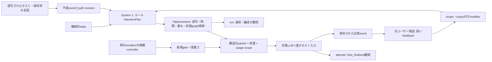

# Hippocampus Ver0.2 実装・運用契約

公開版の現行Ver0.2コードはschema 5です。以下のK1〜K3追記は各工程時点の記録です。
最新の要約処理は[多段階エピソード記憶](episodic-memory-multiresolution.ja.md)、
辞書的記憶の注入は[K4契約](knowledge-retrieval-k4.ja.md)を参照してください。
独立したVer1.0開発基盤は[別の契約・起動手順](../v1/README.ja.md)を持ち、
この文書の移行操作はVer1.0への内容移行には使用しません。

2026-09-20。ここでいう「実装済み」は新コードと架空データによる検証を指す。実DBの移行、常駐サービスの設定変更・再起動、実モデルでの利用品質の測定は別の切替作業である。

2026-09-21追記: [辞書的記憶K1](knowledge-storage-k1.ja.md)の保存・認可・手動review・不変履歴を追加した。新規DBはschema 2となる。既存schema 1は新コードの通常起動で拒否するため、署名backup、write元の停止、明示upgradeを先に行う。起動時の自動変換は行わない。自動候補抽出・外部反証検索・知識の通常注入は後続工程である。

K2追記: [原文に結び付いた暫定候補](knowledge-extraction-k2.ja.md)を追加し、schema 3へ拡張した。明示的な構造化提案の受入と候補化migrationを実装したが、自動的な自然文抽出・外部反証検索・通常注入は有効化していない。

K3追記: [内部反証探索と明示inspection](knowledge-countersearch-k3.ja.md)を追加し、現在のコードはschema 4を要求する。schema 1/2/3は停止中の明示upgradeが必要である。検索完了と反証評価を分離し、結果全件・過去の懸念・出典依存を正規reviewへ接続した。外部検索、自動意味評価、通常注入は未接続である。

## 正規経路



`app.py → v02.api → v02.service → v02.storage`が通常サービスの更新経路。旧MemoryManager、旧API、旧layer同期を呼び出さない。旧コードは明示migration用fixtureと履歴比較に残しており、正常系へのfallbackではない。

`records`はkind別の正規オブジェクトを保存する。Pydantic契約、principal所有権、会話scope、楽観version、冪等receipt、監査appendを一つのトランザクション境界で適用する。event/revision/run/observation/feedback/receipt/migration/memory_versionは不変。memoryの編集前versionも永続保存する。FTSは正規memoryから作る検索用コピーで、整合性検証の対象に含む。現在の候補取得は全件に対する語句照合であり、FTSによる高速化はまだ使用していない。

## 重み・confidence・学習

| 変数 | 現在の更新契約 |
|---|---|
| `retrieval_weight` | 作成時の既定値／記銘信号、または明示review。検索を読んだだけでは更新しない |
| `generalization_weight` | 常に`0`、`generalization_status=unevaluated`。APIで任意上書きできない |
| `salience` | 印象・重要度。自動記銘では感情強度が寄与してよいが、confidence・一般化へ転送しない |
| `assessment` | target/claim/score/status/evidenceを分離。作成時はunknown。証拠付きreviewのみで評価する |
| `stability` | 既存の別変数を保持。三重みの代替にしない |
| edge strength | 別の`learn` command。飽和増分、経時減衰、証拠再送の重複除外。既定で無効 |

世界の真偽、報告の忠実さ、情報源の信頼性を単一confidenceへまとめない。評価不明は数値0ではなくnull。原文を書き換えた際、その本文を対象にしたreport_fidelity評価は未評価へ戻す。旧confidenceはmigration_originalに保存し、現在の評価値に昇格しない。

検索scoreは語句一致、retrieval_weight、salience、stability、時刻、観測された注入頻度、一時modifierを別成分として記録する。注入頻度はhost_finalized観測から読む派生値であり、モデルがその記憶を利用した回数とは呼ばない。検索・最終注入観測はmemory本文、恒久重み、edgeを変更しない。

System 1は現在ルール実装で、自由文を生成しない。語句方向、scope、graph深度、state/modifier参照、risk未評価を構造化出力する。機能的stateの探索準備度で深度を一時変更できる。小型モデルの呼出しは未接続。

graphは`co_occurrence / temporal_next / semantic_related / co_recall`を区別する。共起は共有元event、時間順は順序付き別event、co-recallは両ノードの編成と最終残存観測を要求する。modifier/stateに誘導された共想起、およびgraph展開で自ら呼び込んだ共想起からの再強化を拒否する。意味関連の判断は認可されたlearn側の責任であり、自動埋め込み判定ではない。

係数・30日減衰・深度上限3・graph追加展開上限100は初期評価用のpolicy値。最後の上限は計算量制御であってpromptのtoken枠ではなく、語句一致で選択された記憶の一律切捨てには使わない。学習を有効化する前に用途別に検証する。

## scopeと永続性

同一principal内で`visibility=principal`の記憶を別会話から想起できる。その記憶の元会話の現在選択branchに根拠が残っていることも確認する。`visibility=conversation`は他会話へ出ない。親記憶より広いvisibilityの派生記憶を作れない。fictionはsandbox IDも一致する場合だけ使用する。

実際のeventをfictionへ付け替えたり、fictionの根拠で現実memoryを作ったりする更新は拒否する。枝変更では元event・memoryを消さず、現在経路の想起対象から外す。validityが過去になった記憶も保存し、`temporal_scope=historical/all`で探索できる。

期限を持つのはmodifier・機能的state・表現scope。期限切れで作用を止め、履歴は削除しない。通常APIとnightlyに物理削除処理はない。nightlyは現在の選択経路にある未記銘のユーザーeventを再評価するルール処理で、旧LLM要約・削除・旧confidence更新は実行しない。

## 選択・注入・応答・feedback

1. `dialogue/sync`は`expected_revision`を必須とする。新会話だけnullを許す。不変eventは内容を変えて再送できない。
2. `context/runs`は現在revisionを確認し、選択UID、選択時versionとscore内訳、編成UID、packet digestを保存する。
3. `attempts`はrun、path_revision、model、host、packet digestを固定する。
4. `host_finalized`は`retained/not_present/empty_context/blocked_capacity/unknown`を区別する。認可されたホストによる報告であり、偽装不能な証明ではない。
5. `dispatch`を報告する場合は開始→結果の順序とrequest digestを確認する。現在のOpenWebUI接続が自動報告するのはhost_finalizedまで。provider変換後・実モデル内部の観測はunknownのまま。
6. 保存されたassistant eventを一つのattemptへ対応付ける。別モデル、別枝、後続ユーザーturnの応答、同じ応答の複数attempt対応を拒否する。
7. 次のユーザー発話を四分類し、弱いfeedbackを記録する。表示応答との対応を確定できない場合は推測しない。

訂正分類は内容・帰属・過剰一般化・文脈不適合。引用とコード部分をマスクし、根拠spanを保存する。検出confidence 0.65は校正済み確率ではなく、`uncalibrated_heuristic`と明記する。皮肉や含意の理解は未解決であり、分類の正しさを保証しない。「訂正なし」は成功報酬ではなくunknown。

feedbackの対象memoryが分からないときはtarget_refsを空、unresolvedとする。既定では記録のみ。`HIPPOCAMPUS_V02_FEEDBACK_EFFECTS=1`の場合だけ会話/context_key/sandboxとexpiry付きmodifierを作る。過剰一般化はgraph深度を0、文脈不適合は一時的に現在会話へ検索scopeを絞り、内容・帰属訂正では根拠付き候補への優先を与える。合成寄与には上限がある。単発訂正から本文、真偽、恒久weight、edgeへ直接書き込まない。

## 機能的stateと表現sandbox

機能的stateは`uncertainty_load / attention_urgency / exploration_readiness / caution_gain / integrity_pressure / information_gap`だけを受け付ける。自己価値・能力低下・人間的感情ラベルを通常制御値として受け付けない。未解決項目は五状態、期待情報利得、再開条件を持ち、負の完了報酬を持たない。

sandboxの制御入力は独立した`control`権限が必要。通常ホスト用credentialにはその権限を付けない。controllerが根拠event、fictionとして扱えるか、現実行動の現在進行性、損失可能性、規模、制御可能性、可逆性、認知的影響力を明示する。自然文からこれらを自律判定する分類器はまだ実装していない。

認知的影響力はcaution gainへ渡し、高いだけでは危険としない。fictionとして安全に扱えず現在の現実行動・損失がある場合は客観的支援を即時要求し、表現gainを段階低下する。urgentなら0へ。fiction安全と現在の現実損失の両方を同時に主張する矛盾入力は拒否する。

再没入には現在行動の解消、fictionとしての安全確認、根拠event、有効scope、段階的な認可更新を要求する。expiryやscope無効化でgainを0にしても、未解消の現在リスクを解決済みにしない。増分0.25・減分0.5は評価用初期値。gainは表現設定であり、客観判断やAPI権限を変更しない。

## API認可

サーバーのregistryは`token_sha256 / principal_id / host_id / permissions`を対応付ける。要求本文のprincipal指定を信頼しない。権限は`read/write/review/sync/observe/control/learn/admin`に限定し、adminを暗黙の全権にはしない。通常ホストにadminやlearnを渡さない。複数の利用者には別tokenとprincipalを割り当てる。

readによるcontext生成にもrun/receiptの観測記録は発生するが、記憶の恒久重み更新は発生しない。バックアップと監査全体の検証は管理者操作。ローカルoffline CLIの権限境界はOSのDB・鍵へのアクセス権であり、Web APIとは別の管理面である。

## 明示migrationと切替

```text
python scripts/migrate_v02.py --source old.db --destination new.db --principal owner
python scripts/migrate_v02.py --source old.db --destination new.db --principal owner --apply
```

最初はdry-run。apply時も移行元はread-onlyで開き、旧値の通常更新経路を作らない。既存canonical memoryを優先し、旧型のみを一度だけ変換する。UID衝突はmanifestへ記録する。旧confidenceと原文は履歴へ保存。境界・根拠を証明できないものは隔離し、架空の独立episodeにしない。

移行元audit chainは検証する。外部anchorとの照合はまだ行っていないため、reportに`external_source_anchor_verified=false`を残す。移行前に管理者が旧側の署名・外部anchorも確認する。新epochは別の鍵・anchor・backup領域を作り、旧設定の保存先を継承しない。

manifest/source digest/ownerが同じ再実行は冪等。失敗時の`.migration-pending`があれば通常起動を拒否し、同じ移行入力での再実行を要求する。既存の別migrationや通常記録があるDBへ混ぜてimportしない。移行元が複数所有者を含む場合、このCLIで単一principalへ割り当てない。所有者ごとに確認した入力が必要。

切替は旧writer停止→最終snapshot固定・検証→新DB import→新credential配置→ホスト・nightly・サービスの新環境設定→新API検証→再開の順。旧APIへのfallbackやdual-writeを作らない。新規記憶を作った後に旧DBへ戻す運用はしない。

## バックアップ・復元

`POST /api/v0.2/backups`はadmin権限で署名付きsnapshotを作成する。復元は停止中だけ明示実行する。

```text
python scripts/restore_backup.py backup-filename.db --db new.db
python scripts/restore_backup.py backup-filename.db --db new.db --apply --service-stopped
```

復元前の監査headを固定し、新branchとして採用する。復元前のrecovery DBも作るため、後日の明示削除の残存copy確認対象になる。失敗時は`.maintenance`を残し、通常更新を止める。markerは障害を調べずに削除しない。

## 明示削除

初期実装の削除単位は**principal全体**。個別ノードの選択削除UI/APIは未提供。モデル向け通常APIから実行できず、offline operatorが対象principalと操作IDを明示する。

```text
python scripts/erase_v02.py --db new.db --principal owner --operation-id user-request-001
python scripts/erase_v02.py --db new.db --principal owner --operation-id user-request-001 --apply --service-stopped --confirm-principal owner --purge-managed-backups
```

最初は計画表示。実行では対象のevent、memory、旧version、run、feedback、receipt、FTS、旧audit内の識別子を除く新しい署名epochを作る。他principalの正規record・versionは維持し、新epochへ再監査する。旧epochそのものの完全な監査連続性は維持しない。削除要求を優先して境界を明示する。

削除済みprincipalへの通常writeは以後拒否し、保存済みフロントエンド会話の自動再同期による復活を防ぐ。再利用する場合は利用者の意図を確認して新principalを明示設定する。旧credentialの失効とフロントエンド側のデータ処理も切替担当者が行う。

`--purge-managed-backups`は全管理backupの削除を明示する指定で、他principalを含むsnapshotも対象となる。指定しなければbackupを残し、未完了を報告する。移行元・復元前recovery DBの所在も報告し、自動削除しない。これらが残れば`complete=false`。同じ操作IDの再実行は当時のreceiptを返し、残存コピーの後処理や再検査を代行しない。

`complete`の対象は把握しているアプリ管理下の論理コピー。フロントエンド会話DB、provider側ログ、手動コピー、OS snapshot、SSDの物理残存まで消去したという証明ではない。新DBへの論理削除と媒体の消去は区別する。失敗時はmaintenance markerにより通常処理を再開させない。

## 検証範囲と残る測定

新しい受入試験は`tests/test_v02*.py`。架空fixtureだけを使い、認可、重み分離、感情とconfidence、枝・モデル・応答対応、feedback、expiry、sandbox、graph循環、prompt境界、容量、migration、署名復元、明示削除を検証する。旧80テストの互換性合格を目標としない。

実際のモデルによるactor保持・scope遵守・過剰一般化、prompt増加量、first-token latency、p50/p95、feedback誤検出率、provider変換後の欠測は今後の測定事項。ホスト最終残存を「モデルが利用した」「有用だった」と読み替えない。一般化の自動更新、SLM/embedding routing、LLM夜間要約、高度なhost偽装耐性は有効化していない。
