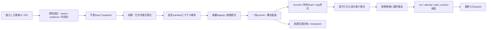

# Hippocampus Ver1.0 開発基盤

この実装は、新正規DB・文脈想起・共通学習計画の**架空データによる開発版**です。Ver1.0全体の受入完了版ではありません。既存DBの内容、鍵、監査epoch、設定、旧APIを入力・依存関係にしません。

`v02`以下へのimport、旧サービスへのrouting、migration、backfillはありません。新規作成時は既存ディレクトリを拒否し、通常起動時は新形式のworkspace markerを確認してから、固定名の新DBだけを開きます。`data_class`は`synthetic`だけを受け付けます。この申告は内容の自動判定ではないので、実ログを架空データとして登録してはいけません。

## 実装の範囲

| 計画工程 | 現在実装した部分 | 未完了の受入条件 |
|---|---|---|
| P0 契約 | `records.id`、参照`event_id`、独立owner、三つの記憶重み、四値の時刻品質、型付き条件、専用認可 | ライブ収録・新hostまで含む最終契約の固定 |
| P1 基盤 | 新DB・新鍵・新epoch、Raw snapshot、staging、owner付きFK、署名監査、時刻版、map世代、区間台帳、署名backup、別workspaceへのrestore | 複数ownerの部分消去、差分を失わない復旧合流の運用 |
| P2 共通学習 | 同じ正規化・prompt・model adapter・出力schema・根拠検証を初期／日次／再解析に使用。モデル設定をmanifestへ固定 | 実モデルによる意味要約・話者帰属・記憶抽出の品質受入 |
| P3 投入／差分 | transaction、冪等receipt、初期release非公開、完了時公開、連続区間checkpoint、時刻訂正と依存失効、再解析の時刻版固定 | ライブ受信中のturn確定管理、再処理queueの自動実行、後継派生物の版管理拡充 |
| P4 想起／拒否 | 認可後の語句／context／edge候補和集合、所属の有界集約、状況modifier、record倫理五軸、完全turn生ログ枠、送出前再認可 | 時間減衰する前回活性、context倫理との合成、非内容的対話style、Hebbian更新方針との接続、新対話hostへの接続 |
| P5 UI／観測／運用 | 独立API／画面、モデル・範囲選択、学習状態、staging、時刻訂正、全履歴・日本語部分検索・全ページ抽出、直近2turn、部屋・guest切替、選択／最終入力の分離 | 日次自動job管理、カレンダー集約、運用UI拡充、Observatoryの新契約接続 |
| P6 全システム受入 | 架空データの契約・結合・障害注入・API・画面確認 | 1万／10万／100万件性能、実モデル品質、上記必須残件を含む全受入 |
| P7 実ログ初期学習 | **未開放** | P6完了と実資料・所有者・利用先の明示指定が必要 |
| P8 日次運用 | 差分処理は手動実行可能 | 新host／job管理を含む運用受入 |

未実装の機能をテスト代替器で完成扱いにはしません。`tests/test_v1_learning.py`の`FictionAnalyzer`は構造試験専用で、意味解析モデルではありません。既存サービスの設定変更・再起動・DB切替はこの開発手順に含みません。

## 構成



| ファイル | 責務 |
|---|---|
| `contracts.py` | 新契約。モデルはowner、アクセス許可、真偽確定、原文を書き換えられない |
| `normalization.py` | UTF-8 JSON、原文保持、role変換、stable ID、sequence、四値の時刻 |
| `analysis.py` | 共通prompt、構造化出力schema、OpenAI互換HTTP、span／role／digest照合 |
| `learning.py` | Raw append、snapshot固定、容量別turn分割、staging、公開、map、checkpoint |
| `storage.py` / `schema.sql` | 新DB、トランザクション、Ed25519監査、anchor回復、FK、整合性検証 |
| `access.py` | ownerと利用面・送信先・restrictedの絶対拒否 |
| `memory.py` | 認可済み履歴、cursor、時刻訂正、手動所属、状況、検索、最終入力 |
| `operations.py` | 独立backup／restoreと明示的な単一owner workspace消去 |
| `api.py` / `ui/` | 新APIと架空データ開発画面 |

## 契約上の重要事項

### 原文と時刻

- 元ファイルのbyte列をsnapshotへ保存し、元メッセージ、原文、順番をモデル出力で置換しません。
- 同じsourceのappendは既存メッセージの完全一致を要求します。本文・時刻metadataが変わった場合は拒否します。任意の旧DB取り込みはありません。
- IDは新epoch／source／sequenceから決まります。同文の別発話は別IDです。
- 開始日時＋既知総時間は`(sequence-1)*D/(N-1)`。N=1はoffset 0で、先頭も`estimated_uniform`です。
- 総時間欠落・null・`unknown`から2分間隔や絶対日時を作りません。
- 概略期間の2分offsetは順序上の仮定です。`event_time=null`のままで、概略期間を原文字列として残します。
- 明示offset／timezoneがない日時、DSTの曖昧時刻、無効JSON、未知roleを無断補修しません。
- exactでも元の分／秒／ミリ秒精度を残します。不明な誤差はnullです。
- 時刻訂正はimmutable revision＋head切替です。原文／sequence／checkpointは変えません。古いcursor・選択済み入力を失効させ、影響する派生物を要再確認として検索選択から除外します。履歴からは参照できます。
- 再解析は現在の時刻headを入力へ固定します。解析中に時刻版が変わった場合は、新manifestでの再実行を要求します。

### 学習と公開

- snapshot全体で正規化してから範囲を選ぶため、部分範囲選択で等間隔推定のNは変わりません。
- userと応答・tool群の途中を処理範囲境界にできません。収まらない単一turnは明示エラーにします。黙って切り捨てません。
- `context_only`は読解専用で、そこだけを根拠に新規記憶や所属を生成できません。根拠に用いる読解専用eventは既に正規保存されている必要があります。
- 原文spanはUnicode codepointの半開区間です。quote、digest、role、versionを厳密に照合します。
- 通常の有効出力に全件手動承認は要求しません。時間の矛盾・競合はreviewへ分離します。構造検証を意味的真偽の証明とは扱いません。
- 初期runは最後のbatchまで公開しません。日次は検証・投入済みbatchを公開します。checkpointは公開済みの連続区間だけ進みます。
- 同じcommitの再送はreceiptを返し、同じ冪等キーで内容が変わる場合は409です。receipt再取得時も認可を再確認します。
- 再分類はmapをコピーして新世代を作ります。手動所属・対象外所属・空出力時の既存所属を保持します。0.8と0.3を合計1へ正規化しません。
- `retrieval_weight`、`generalization_weight`、`salience`は別フィールドです。記憶の`confidence`はnullの未評価値として保存し、感情やsalienceから埋めません。所属のconfidenceも所属weightとは別です。
- 未評価モデル出力から`generalization_weight`を0より強めることは拒否します。独立した裏付けのreview・一般化強化操作は別途実装する対象です。
- 意味候補は`epistemic_status=unassessed`です。要約モデルの提案を、そのまま確立した知識やユーザー承認済み現在状態に昇格させません。

### 認可と想起

- `public`もownerを越える公開承認にはなりません。guestにはpersonal／privateを渡しません。restrictedは通常の学習・参照・検索・件数・packetから除外します。
- 派生記憶とcontextは現在の原文アクセス制約も再確認します。原文を制限した後に、以前の要約やcontext名だけがモデルへ漏れる経路も遮断します。
- 状況はsurfaceごとです。期限切れでprivateアクセスを自動復活させません。room modifierは別端末に持ち越しません。
- modifierは型付きAND／OR／room／audience／時間帯／曜日で、evalは使いません。一つのOR条件に複数一致しても一回だけ適用します。
- 倫理五軸の加点・減点は認可の後です。負の抵抗や最大weightでアクセス拒否を覆せません。
- tokenは現在、UTF-8 byte数による保守的上界です。実測token数と表示しません。Raw枠は既定12,500で変更可能、model全体容量とreserveが優先します。
- 直近Rawは完全turnで採用し、収まらないturnを部分削除しません。UIの2turn表示・非表示とは別です。
- `prepare`は候補選択、`finalize`は再認可した入力packet生成です。providerが受信／消費した事実は未観測と明記します。通常LLMへの実送信はまだこのサービスに接続していません。
- 古い入力を渡す前に、所有者・surface・送信先・権限・状況・時刻／記憶の版を再照合します。provider変換後の追跡は別工程です。

## 開発手順

リポジトリのルートを作業場所とします。依存は`v1/requirements.txt`です。HTTP境界の自動試験には`httpx`も必要です。既存デプロイの設定ファイルや環境変数をコピーしないでください。

```powershell
python -m v1 init --workspace ./v1-workspaces/fictional-development
python -m v1 verify --workspace ./v1-workspaces/fictional-development
python -m unittest discover -s tests -p 'test_v1_*.py' -v
```

新UIを起動する場合は、別途、新しいservice設定を明示指定します。設定のschemaは`hippocampus.service.v1`、data_classは`synthetic`です。通常対話modelと別modelの一覧、default_model、**新規発行した**24文字以上のbearer tokenとそのIdentityを指定します。旧tokenは流用しません。

```json
{
  "schema": "hippocampus.service.v1",
  "data_class": "synthetic",
  "default_model": "development-model",
  "models": [{
    "id": "development-model",
    "provider": "openai_compatible",
    "model": "EXPLICIT_MODEL_NAME",
    "endpoint": "http://127.0.0.1:EXPLICIT_PORT/v1",
    "destination": "local",
    "context_window": 32768,
    "output_reserve": 4096
  }],
  "credentials": {
    "REPLACE_WITH_A_NEW_RANDOM_TOKEN": {
      "principal_id": "fictional-owner",
      "trusted_private": true,
      "permissions": ["sources.write", "learning.run", "learning.commit", "learning.review", "records.read", "time.write", "contexts.write", "policy.write"]
    }
  }
}
```

この例のmodel名・port・tokenは有効な設定ではありません。実際の接続先・独立したtokenを明示設定します。service設定は公開しないでください。

```powershell
python -m v1 serve --workspace ./v1-workspaces/fictional-development --config ./v1-workspaces/service-config.json --port 8767
```

serveはloopbackにだけbindします。既存サービスの起動・停止・設定切替を行いません。Web画面は接続tokenをlocalStorageやcookieへ保存せず、全APIを`no-store`にします。

架空の入力例は`tests/fixtures/v1/fictional_garden.json`です。実ログを使う試験はありません。`tests/v1_ui_preview.py`は一時的な画面確認用で、意味解析に明示的なテスト代替器を使います。通常serveからテスト代替器へのfallbackはありません。

## 運用と残る制限

- backupは新workspace内の`backups`へ作成し、独立に保持した公開鍵で署名・全ファイルdigestを検証します。restoreは存在しない別ディレクトリへだけ行えます。稼働中DBへの上書きは拒否します。
- 現在の消去は単一ownerの**新しい架空workspace全体**に限定し、確認文字列とepoch一致を要求します。Raw、staging、時刻版、所属、receipt、ローカルbackupを含みます。複数ownerの部分消去は未実装です。
- ユーザーがダウンロードして別の場所に保存したexport／backupコピーは、別途削除管理が必要です。この制約を「全コピー消去済み」と表示しません。
- 履歴の検索・認可済み集合の構築は現状フルスキャンを含みます。FTSの整合性は監査しますが、FTS索引を利用した候補の絞り込みと大量件数性能の受入は未完了です。
- sourceのappend snapshot、map世代は正確性を優先してコピーを保持します。1万／10万／100万件の評価と保存量の最適化を行う前に実運用へ切り替えません。
- 未完成のライブ収録、日次scheduler、再処理worker、Observatory接続を、既存V0.2経路へのfallbackで補いません。
- P6は未完了です。実ログ取り込み、既存DB移行、既存サービス切替を行う手順は提供していません。
